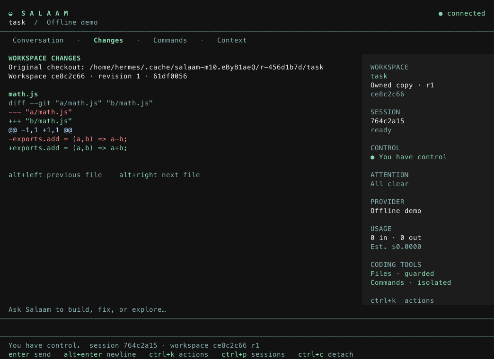

# Salaam

A persistent home for agent work. Code in the terminal, step away, and return to
the same session, tasks, approvals and results.

[Website](https://salaam.sh) · [Documentation](https://docs.salaam.sh) ·
[Releases](https://github.com/SuperJackfruitLabs/salaam/releases) ·
[Changelog](CHANGELOG.md) · [Apache 2.0](LICENSE)

```sh
sal service start                     # a persistent local session service
sal session create --cwd "$PWD"        # create once; keep the returned session ID
sal attach SESSION_ID                 # a terminal window onto the same work
sal attach SESSION_ID --observe       # inspect it from another terminal
sal remote my-vps --session SESSION_ID # reconnect on your execution host over SSH
```

## Work should outlast a terminal

Closing a client should not discard an agent's session. Reconnecting should not
submit the same instruction again. And an agent saying “done” should not be the
only evidence that a task succeeded.

Salaam runs a service on your machine or execution host. A pinned Pi worker owns
the conversation; Salaam owns the durable task and operation records. The terminal,
SSH and ACP editor clients all connect to that same service.

The terminal has **Night** and **Paper** themes, a multiline composer, reviewed
changes, command logs, approval review and an operator inbox.



## Install

Use **Node 26.7.0** and npm **11.19.0**. macOS and Linux are supported; Windows is
not currently tested. Packages include compiled CLI code and pinned production
dependencies. No compiler, checkout or database server is needed.

Install the latest stable release:

```sh
curl -fsSL https://salaam.sh/install.sh | sh
salaam --version
sal --help
```

The installer verifies the release tarball's SHA-256 checksum and installs both
executable names. You can [read the installer](https://salaam.sh/install.sh) before
running it. To choose a version or private prefix, pass arguments to `sh`:

```sh
curl -fsSL https://salaam.sh/install.sh | sh -s -- --version 0.0.2 --prefix "$HOME/.local"
export PATH="$HOME/.local/bin:$PATH"
```

Or install from npm:

```sh
npm install --global @superjackfruitlabs/salaam@0.0.2 --ignore-scripts
```

See [installation and upgrades](docs/install.md) for direct
tarball installation, prerequisites and safe state migration.

## Your first session

The default provider is offline: prove local readiness and attachment without an
API key or a paid request.

```sh
sal service start --state /tmp/salaam-try
sal session create --cwd "$PWD" --state /tmp/salaam-try
sal attach SESSION_ID --state /tmp/salaam-try
```

Replace `SESSION_ID` with the returned ID. Enter an instruction, detach with
Ctrl+D, then attach again. Ctrl+K opens actions; Ctrl+O opens approvals.

Choose a provider with `sal providers list` and a model with `sal models list PROVIDER`. Salaam exposes all 41 chat providers in pinned Pi, including API-key, OAuth and cloud authentication. ChatGPT subscription routes support interactive sessions and durable tasks that explicitly disable token budgeting; these routes cannot enforce an output-token ceiling.

For Claude, use the hidden terminal prompt and a separate provider-bound service:

```sh
sal auth set anthropic
sal service start --provider anthropic --state "$HOME/.local/state/salaam-claude"
sal session create --cwd "$PWD" --state "$HOME/.local/state/salaam-claude"
sal attach SESSION_ID --state "$HOME/.local/state/salaam-claude"
```

Claude prompts are billable. The saved key is a private plaintext file protected
by OS permissions. See [providers and credentials](docs/providers.md).

## What stays with the work

| Capability                                       | What it means                                                                                                                |
| ------------------------------------------------ | ---------------------------------------------------------------------------------------------------------------------------- |
| [Sessions](docs/service-reference.md)            | Durable dispatch, client outboxes, controller leases and committed event replay.                                             |
| [Coding](docs/coding.md)                         | Owned workspace copies, hash-bound patches and isolated commands through a proven Docker backend.                            |
| [Tasks](docs/durable-tasks.md)                   | Stable steps, checked plans, budgets, checkpoints and opt-in bounded progression. Model text cannot complete a checked task. |
| [Specialists and teams](docs/agents.md)          | Admitted profiles, isolated coding proposals, explicit integration, durable task-step claims and passive messages.           |
| [External harnesses](docs/external-harnesses.md) | Pinned Gemini, Claude ACP and Codex workers with explicit invocation limits and shared approvals.                            |
| [A2A peers](docs/a2a.md)                         | Authenticated, bounded peer analysis, explicit inbound grants and durable task ownership.                                    |
| [Jobs and schedules](docs/jobs.md)               | Occurrence deduplication, immutable recurring templates and explicit missed-run and timezone/DST policies.                   |
| [Host operation](docs/host-operation.md)         | Reviewed runtime/backend manifests, bounded supervisor restart and a shared CLI/TUI/ACP inbox.                               |
| [Clients](docs/clients.md)                       | Terminal attachment, SSH and ACP v1 against the same service.                                                                |

## Read this before trusting it

Salaam is early software for **one trusted OS account**. Its Unix sockets do not
isolate hostile programs running as that user. Coding tools are opt-in; commands
require a proven execution backend. There is no public multi-tenant API.

Detaching leaves admitted work running. Daemon death interrupts dispatched
attempts; they are never silently replayed. An uncertain external operation stays
unknown until reconciled, and cancellation cannot undo prior effects. Request
and token limits do not establish a currency spend cap.

See [limitations and recovery](docs/limitations.md), the
[execution boundary](docs/execution-boundary.md), and the
[verification record](docs/verification.md). Evidence identifies the revision and
environment observed; offline tests do not prove live-provider availability.

## Develop and release

```sh
nvm use
npm ci --ignore-scripts
npm run setup:cli
npm run format:check
npm run check
npm test
npm run release:pack
npm run test:package
```

`setup:cli` links both aliases to this checkout. Install the sites' separate
dependencies with `npm --prefix landing ci --ignore-scripts` and
`npm --prefix docs-site ci --ignore-scripts`, then run `npm run sites:build`.

The release workflow reruns service and execution proofs, tests the **same tarball**
from an empty npm cache on macOS and Linux, then publishes a complete GitHub Release
with checksums and build provenance. npm trusted publishing is a separate opt-in.
Published assets are never silently replaced.

See [release process](docs/releases.md), [site maintenance](docs/sites.md),
[architecture](docs/architecture.md), and [milestones](docs/milestones.md).
