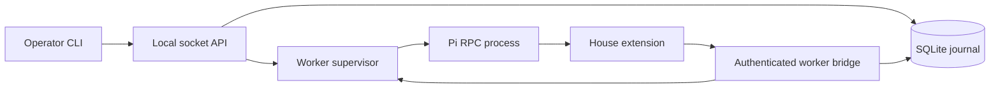

# Session service architecture

The operator API and private worker bridge share a service process. Pi runs in a separately supervised process, with a managed agent directory, explicit session identity, pinned house extension, builtin execution tools and MCP disabled, and one offline provider route.

Pi owns the conversation tree. Salaam imports read-only entries, cursors and active-leaf references after a turn settles. Salaam owns session lifecycle, accepted inputs, attempts, controller leases, request responses, artifact references and ordered durable events. It does not maintain an independently editable model transcript.

## Readiness and grants

Each start allocates a new durable epoch. The worker receives a fresh private credential and context nonce. Its manifest must match the service's protocol, package/extension bundle digest, policy digest, session identities, capability set, tool set and provider route. A subsequent RPC state query confirms the actual Pi session path and selected model.

No prompt is dispatched until readiness commits. Every provider admission validates the actual outgoing task-context frame. Every tool checks policy, and the tool implementation obtains its own service grant before reporting success. Nested tool failures invalidate readiness. A manifest claim alone does not supply isolation: the house extension and pinned bundle are trusted code, with runtime failure tests covering those boundaries.

The bridge compares worker credentials and epochs. A persistence failure prevents a grant and revokes readiness in memory even if the unhealthy state cannot be written. The operator's inspection includes that live failure, so a stale persisted `ready` row cannot mask the denial.

## Persistence and delivery

SQLite transactions include both the mutation and its event. Durable request IDs return saved responses after retries, even if the original revision has advanced. SSE subscribes to commit notifications and catches up from the database; client connections never own worker lifetimes.

The client outbox flushes an instruction and stable request ID before sending. A lost acceptance response leaves the original record intact. Reattachment retries that logical request, even with a new controller credential. Cache lookup precedes lease/revision checks. A definite revision rejection permits rewriting the pending revision; unknown outcomes do not. Definitively invalid records are retained separately for inspection.

One controller lease permits new input; observers only read. Lease acquisition/release/takeover advances a controller epoch, renewals retain it, and service recovery revokes all leases. Takeover does not stop an active prompt. Leases coordinate trusted clients and do not isolate applications running as the same OS user.

The dispatcher is independent of attachments and runs one attempt per session. Its states are `accepted → dispatching → running → completed/failed/interrupted`. The service commits `dispatching` before writing the Pi prompt. Pi's `started` disposition is acceptance into a run, not proof of completion. A settled run, actual error outcomes and transcript collection determine the attempt result. Transcript import and completion share one transaction so a snapshot cannot expose a completed answer ahead of its completion event. A completed turn is not proof of success for an external operation.

Snapshot projection follows the imported active leaf and bounds history and text. SSE replays committed events from that snapshot's cursor, handles socket backpressure and disconnects a persistently stalled consumer. Volatile previews have no event ID; the terminal renders committed results and does not use preview text as a recovery record.

Artifacts are written, flushed and renamed before their references commit. Their content digest is checked on read. SQLite and Pi JSONL remain separate persistence domains; these tests establish process-crash behavior, not universal host-loss recovery.

The service lifetime lock is held by a separate SQLite rollback-journal connection. This remains locked even while ordinary journal transactions commit, and the OS releases it when the process dies. The service keeps that lock handle reachable until shutdown.

## Process recovery

Pi processes get their own process groups and a name containing the session, epoch and unique service boot ID. The service records process identity before considering the worker ready. On restart it inspects that identity before signalling an old group. An unrelated reused PID is not signalled. If a previous writer cannot be proven stopped, recovery blocks the session rather than risking a second writer.

Workers also stop after bridge loss. Recovery does not adopt a live worker after supervisor death or replay unknown prompts. Once old workers are fenced, `dispatching`/`running` attempts become `interrupted`; `accepted` attempts remain queued. This includes the gap before a pipe write and the gap after Pi settles but before SQLite completion commits. Pi JSONL and SQLite cannot atomically acknowledge a prompt, so uncertainty is preserved rather than inferred away. Empty Pi sessions may not yet have a JSONL file; they retain their explicit session ID when restarted. A missing transcript with recorded model activity is an integrity failure.

Ordinary worker stop, service stop and client disconnection are different lifetimes. The detached service outlives its launcher and attachments. Ctrl-C/Ctrl-D detaches; shutdown stops workers and records active interruptions before closing the journal. `resume` provisions the recorded session and permits safe queued dispatch after readiness. An unresolved interrupted attempt blocks the queue. Explicit continuation creates a new attempt with new instruction text, links it to the interrupted attempt and takes priority over prior queued work. Cancellation controls remain future work.
