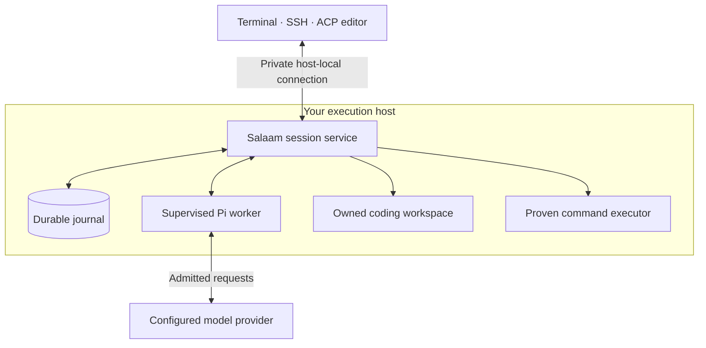

# How Salaam keeps your work

Salaam separates the lifetime of your terminal from the lifetime of your agent's
work. Clients connect to a service on your machine or execution host. That service
keeps the durable record and supervises a pinned Pi worker for each session.

SSH runs the client on the execution host. It does not expose a public Salaam
listener or move the session to your laptop. A second client sees the same
session IDs, task steps, approvals and results.

## Who owns what

| Component        | Responsibility                                                                                  |
| ---------------- | ----------------------------------------------------------------------------------------------- |
| Client           | Shows state, saves pending actions to its outbox, and follows committed results.                |
| Session service  | Owns session lifecycle, durable dispatch, task state, policy, approvals, receipts and recovery. |
| Pi worker        | Owns the conversation tree and runs the admitted agent turn.                                    |
| Coding workspace | Holds an owned copy with reviewed revisions and hash-bound patches.                             |
| Command executor | Runs commands in disposable copies under a fixed, proven profile.                               |
| Provider         | Produces model responses; its completion text does not certify task success.                    |

## Detach and reconnect

A client saves an instruction and stable request ID before transmission. If a
response is lost, it retries the same logical request. The service returns its
saved acceptance rather than creating another attempt. Reconnecting also replays
committed events from a cursor, so clients can catch up without owning the worker.

One client holds a renewable controller lease for new prompts and cancellation.
Other clients can observe. Explicit takeover changes control without restarting
an active turn. Approval decisions are separate from prompt control and apply
only to their reviewed binding.

## Restart and interruption

Detaching leaves the service and admitted work running. A service or worker crash
is different: dispatched attempts become interrupted and require inspection and
explicit continuation. They are never inferred complete from a transcript or
silently replayed. Work still safely queued retains its original identity.

Recovery checks that old writers have stopped before permitting a replacement.
Every replacement worker proves its bundle, session identity, policy, provider
route and required controls before receiving new grants. Uncertain process or
operation ownership blocks new work.

## Coding and checked completion

Child work has a durable worker identity and a frozen owner, diagnostic profile,
provider route and request limit. Inspection shows that binding and its dispatch
state. Reconnecting returns the same child and result; a crash interrupts its
execution instead of silently launching it again. Child tools currently remain
limited to the readiness probe.

A coding session imports an owned workspace copy. Durable edits bind the expected
revision and content hashes; commands use disposable snapshots with the fixed
executor profile. A detached client does not discard those identities or logs.

A checked task binds a plan, steps, budgets, workspace and acceptance checks.
Automatic progression is opt-in and bounded. Final success requires fresh check
receipts and deliverable evidence for that scope. A model saying “done,” an old
passing command, or an inbox acknowledgement cannot substitute for that evidence.

## Decisions and uncertain effects

An approval binds the target, arguments, expected version, policy and worker that
you reviewed. Intent commits before managed dispatch. A positive matching receipt
can establish success; a lost response can leave the effect unknown.

Cancellation revokes future dispatch but cannot undo work already accepted by an
external system. Unknown effects require reconciliation or explicit recorded
operator resolution. Reconnecting or restarting does not retry them automatically.

## Jobs and host operation

A one-shot job admits one logical occurrence of a reviewed task. Duplicate trigger
keys return the same occurrence. Recurring templates create fresh task, session
and workspace identities for each admitted slot, under explicit overlap and
missed-run policies.

The host supervisor pins the runtime, installed source/build, provider and executor.
It restarts the service with bounded backoff while preserving its journal. Its
restart policy does not grant permission to retry interrupted work.

Read [recovery and limitations](limitations.md), [coding](coding.md),
[durable tasks](durable-tasks.md), [jobs](jobs.md), and [host operation](host-operation.md)
for the corresponding controls.
