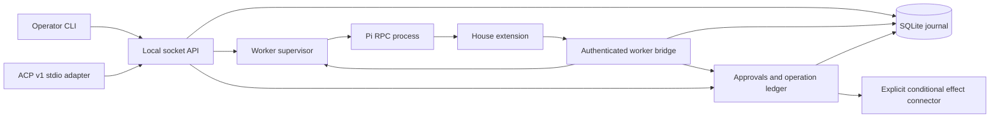

# Session service architecture

The operator API and private worker bridge share a service process. Pi runs in a separately supervised process, with a managed agent directory, explicit session identity, pinned house extension, builtin execution tools and MCP disabled, and either the offline route or a session-pinned guarded Anthropic route.

Pi owns the conversation tree. Salaam imports read-only entries, cursors and active-leaf references after a turn settles. Salaam owns session lifecycle, accepted inputs, attempts, controller leases, approvals, operations/receipts, request responses, artifact references and ordered durable events. It does not maintain an independently editable model transcript.

## Readiness and grants

Each start allocates a new durable epoch. The worker receives a fresh private credential and context nonce. Its manifest must match the service's protocol, package/extension bundle digest, policy digest, session identities, capability set, tool set and provider route. A subsequent RPC state query confirms the actual Pi session path and selected model.

No prompt is dispatched until readiness commits. Every provider admission validates the actual outgoing task-context frame. Every tool checks policy, and the tool implementation obtains its own service grant before reporting success. Nested tool failures invalidate readiness. A manifest claim alone does not supply isolation: the house extension and pinned bundle are trusted code, with runtime failure tests covering those boundaries.

The bridge compares worker credentials and epochs. A persistence failure prevents a grant and revokes readiness in memory even if the unhealthy state cannot be written. The operator's inspection includes that live failure, so a stale persisted `ready` row cannot mask the denial.

## Persistence and delivery

SQLite transactions include both the mutation and its event. Durable request IDs return saved responses after retries, even if the original revision has advanced. SSE subscribes to commit notifications and catches up from the database; client connections never own worker lifetimes.

The client outbox flushes an instruction and stable request ID before sending. A lost acceptance response leaves the original record intact. Reattachment retries that logical request, even with a new controller credential. Cache lookup precedes lease/revision checks. A definite revision rejection permits rewriting the pending revision; unknown outcomes do not. Definitively invalid records are retained separately for inspection.

One controller lease permits new input and cancellation. Approval authority is separate: any authorized client of the trusted OS account can decide, including an observer attachment. Lease acquisition/release/takeover advances a controller epoch, renewals retain it, and service recovery revokes all leases. Takeover does not stop an active prompt. Leases coordinate trusted clients and do not isolate applications running as the same OS user.

The dispatcher is independent of attachments and runs one attempt per session. Its states are `accepted → dispatching → running → completed/failed/interrupted/cancelled`. The service commits `dispatching` before writing the Pi prompt. Pi's `started` disposition is acceptance into a run, not proof of completion. A settled run, actual error outcomes and transcript collection determine the attempt result. Transcript import and completion share one transaction so a snapshot cannot expose a completed answer ahead of its completion event. A completed turn is not proof of success for an external operation.

Snapshot projection follows the imported active leaf and bounds history and text. SSE replays committed events from that snapshot's cursor, handles socket backpressure and disconnects a persistently stalled consumer. Volatile previews have no event ID; the terminal renders committed results and does not use preview text as a recovery record.

Artifacts are written, flushed and renamed before their references commit. Their content digest is checked on read. SQLite and Pi JSONL remain separate persistence domains; these tests establish process-crash behavior, not universal host-loss recovery.

The service lifetime lock is held by a separate SQLite rollback-journal connection. This remains locked even while ordinary journal transactions commit, and the OS releases it when the process dies. The service keeps that lock handle reachable until shutdown.

## Process recovery

Pi processes get their own process groups and a name containing the session, epoch and unique service boot ID. The service records process identity before considering the worker ready. On restart it inspects that identity before signalling an old group. An unrelated reused PID is not signalled. If a previous writer cannot be proven stopped, recovery blocks the session rather than risking a second writer.

Workers also stop after bridge loss. Recovery does not adopt a live worker after supervisor death or replay unknown prompts. Once old workers are fenced, `dispatching`/`running` attempts become `interrupted`; `accepted` attempts remain queued. This includes the gap before a pipe write and the gap after Pi settles but before SQLite completion commits. Pi JSONL and SQLite cannot atomically acknowledge a prompt, so uncertainty is preserved rather than inferred away. Empty Pi sessions may not yet have a JSONL file; they retain their explicit session ID when restarted. A missing transcript with recorded model activity is an integrity failure.

Ordinary worker stop, service stop and client disconnection are different lifetimes. The detached service outlives its launcher and attachments. Ctrl-C/Ctrl-D detaches; shutdown stops workers and records active interruptions before closing the journal. `resume` provisions the recorded session and permits safe queued dispatch after readiness. An unresolved interrupted attempt blocks the queue. Explicit continuation creates a new attempt with new instruction text, links it to the interrupted attempt and takes priority over prior queued work. A failed worker can be replaced only after all prior writers are proven exited, with full readiness in a new epoch. Uncertain process ownership remains blocked.

## Approvals and effects

Preparation creates an immutable operation binding and a pending approval together. The binding covers session, attempt, worker epoch, tool-call lineage, server-generated action key, normalized argument digest, target/version, policy and connector. Reusing an invocation with different arguments conflicts. A distinct call gets a distinct key; model-supplied text cannot choose a previous key.

Approvals have their own revision, authorized operator scope and durable deadline. Decisions are request-deduplicated before checking stale preconditions, then committed before notifying Pi. No transaction or session lock remains held while waiting for a human. Default expiry is five minutes; the adapter has no independent dialog/turn timer that silently overrides it.

The house tool creates the durable approval before calling Pi confirm. A unique marker carries approval ID and digest; the supervisor persists the mapping to worker epoch and Pi request ID. Labels never route decisions. Bare confirm replies are presentation only: the operation dispatcher still checks the ledger. Worker loss invalidates old dialogs and prepared authority. A cached old decision response is historical evidence and cannot authorize a replacement invocation.

The service owns effect transport. States are `prepared`, `dispatching`, `succeeded`, `failed_definite`, `outcome_unknown` and `cancelled_before_dispatch`. After approval, target preflight runs without a database lock. Immediately before dispatch, the service rechecks the active invocation, approval/deadline, policy, binding, connector and unresolved-operation gate, then commits `dispatching`. The external conditional write closes the target-version race. The fixture connector's lookup mode sends the stable key; opaque mode supplies no idempotency/lookup guarantee.

Receipt validation binds the accepted payload and action key before a success commit. Connection failure after dispatch is unknown, never definite failure. Recovery fences old workers, cancels undispatched prepared operations and marks in-flight operations unknown, then performs read-only status lookup. A positive bound receipt resolves success. Not-found, unavailable lookup, changed connector or mismatched receipt cannot prove nonexecution, so the session remains blocked. Reconciliation never reissues an effect. An explicit operator resolution records its evidence and provenance separately from verified receipts.

Cancellation commits its request, revokes new grants, invalidates pending authority, cancels prepared operations and preserves unknown dispatched outcomes. Pi abort and owned transport abort happen afterward. Already accepted external work may continue. Shutdown drains dispatch, effect transport, lookups and outstanding request handlers before closing SQLite. This includes a target-version preflight still awaiting its connector.

The shipped connector targets an explicit local fixture protocol, not arbitrary production APIs. It uses conditional writes and optional key lookup; shell execution, live production effects, production isolation and durable task verification remain outside this evidence.

## Child lifecycle and usage

Schema v4 adds child tasks, per-attempt request budgets and immutable usage sources. The service commits a new child session, its initial submission/attempt, its reserved budget and its parent step-key binding in one transaction, then provisions a separate supervised Pi process. Each child owns its own transcript and worker epoch. The manifest's tool inventory is reduced to the granted read-only probe; implementation bridge routes also reject child operation dispatch. Maximum depth is one and active concurrency is two per parent session.

Completed, failed, cancelled and interrupted children publish the same fixed result envelope. Bytes are fsynced before a transaction commits the attempt outcome, child final state, artifact reference and parent `child.result_available` event. An unreferenced file after rollback/crash has no delivery authority. Consuming returns the stable result and does not mutate delivery state; explicit acknowledgment commits its own idempotent event. Parent replacement resumes the same inbox. Parent death does not own child process lifetime; service death fences every writer and explicitly interrupts unfinished children without replay. Parent cancellation records child cancellation intent in the same transaction and aborts the relevant processes afterward.

Each parent attempt has a fixed 16-request budget. Child reservations are subtracted before launch; each admission consumes its own allocated request. Reservations are retained, including after uncertain usage, and cannot be reclaimed to fund a duplicate child. These bounds do not claim token or currency limits. New continuation attempts get new parent budgets while old step keys remain bound to their original children.

Provider admission first journals an unknown observation with a generated source key. The fixture provider commits its usage receipt before delivering its final response to Pi; the response carries that source key into the transcript. Importing the same assistant entry joins the existing source instead of adding another amount. Raw Pi entries without request IDs use session/entry keys. Conflicting receipts fail closed. Auxiliary usage, compaction and branch-summary receipts use entry keys; missing/error receipts stay unknown. Pi pricing estimates are labelled separately from known fixture costs. Aggregation sums actual provider observations in each session of the tree; it never sums child aggregate amounts embedded in tool messages. The managed deterministic checkpoint has explicit zero provider usage; arbitrary compaction receipts without usage remain unknown. Live account authentication remains a separate observation.

## Guarded Claude route

Schema v5 stores a public provider route per session: provider, model, maximum output tokens and optional Anthropic workspace ID. Schema-v4 sessions with previous worker activity retain the offline route. A replacement worker must bind to the same route before allocating its new epoch, and readiness cross-checks the manifest and actual Pi selected model. The supervisor requires successful RPC disabling of automatic turn retry and automatic compaction before recording readiness. SDK retries are also zero.

The house extension registers a wrapper around the pinned Pi Anthropic adapter, preserving normalized streaming events and Pi payload, response, header and stream callbacks. The initial route flattens mid-conversation controls into a fixed request tool inventory, uses low reasoning and admits only the selected Sonnet model. Payload hooks may replace the body, but the result is revalidated. The fetch boundary checks the actual serialized body against that approved digest and obtains a service admission before sending exactly one HTTP request. The service independently validates the context frame, selected model, output cap and tool inventory. Inline tool changes, server tools, fallback models and redirect forwarding are denied. A bridge or admission write failure denies HTTP dispatch and invalidates readiness.

The key comes from the service's `ANTHROPIC_API_KEY` environment or the user's mode-600 credential file; the service passes it explicitly to live worker environments. It is not part of the route, manifest, bundle digest, process command line, operation binding or journal. The extension is trusted code, and this is not isolation from another process running as the same OS user. The direct endpoint is fixed to Anthropic. Provider failure bodies are sanitized before Pi persists them. There is no automatic credential discovery, OAuth refresh or external proxy configuration.

Each HTTP admission journals a generated request source key with unknown amounts. A completed Anthropic stream commits usage before the normalized final message is delivered to Pi; the message's `responseId` carries Salaam's source key for idempotent transcript import. Provider pricing amounts are estimates, not billing receipts. An incomplete/error stream preserves an unknown observation. Parent/child trees retain the same route and aggregate provider executions once. Service death interrupts active work and never replays it; explicit continuation reuses the recorded session in a new worker epoch.

## Durable task state and compaction

Schema v6 adds append-only task facts, task heads, compaction attempts and compaction cancellation intents. Task updates have their own expected version and durable request ID; deduplication precedes lease, idle and version checks. Each original statement retains its source request and explicit superseding link. Summaries and models cannot write these operator facts. An evidence artifact must belong to the same session.

The context hook fetches the current facts through the authenticated bridge for every request. The frame binds session identity, a fresh worker binding, version and provenance. The fixed 16 KiB frame budget includes superseded statements; facts are not silently truncated. An update that exceeds that budget or 128 facts rolls back, including its event. Both guarded provider routes validate the actual outgoing payload and its digest against independently fetched current service state. Provider hooks cannot replace the body with stale context. Older text evidence and read-only Pi entries are retrieved through a paginated, session-scoped `salaam_history` tool.

Pi's unrequested automatic compaction remains disabled. A controller, or the explicitly bounded M11 task driver with compaction enabled, may request a deterministic checkpoint only while the parent worker is idle, with no pending approval. The service journals the compaction ID and task version, marks the worker busy before touching its pipe and prevents queued dispatch until the operation settles. The public Pi `session_before_compact` hook requires that service grant and returns a deterministic explicit-task checkpoint, retaining the latest user turn. It does not call a summarization model. Earlier conversation entries remain in Pi's append-only tree and the read-only import. This makes the strategy's preservation boundary inspectable, without claiming preservation of unrecorded semantic facts in a generated summary.

The Pi compaction entry carries the service operation ID and task version. Transcript import, receipt reconciliation, compaction cursor advancement and the completion event share a transaction. A failed or cancelled compaction cannot advance the durable cursor or task version. A lost pipe result is interrupted and fences the worker; a replacement imports persisted entries before readiness and resolves success only from a matching receipt. It never replays an uncertain compaction. A cancellation intent commits before Pi abort. Positive persisted completion wins a race with cancellation. Child inboxes, approvals, unknown operations and task facts remain separate structured state.

## ACP ownership and delivery

The ACP adapter is a separate operator client using the same local socket, controller leases and journal as terminal attach. It implements the tested ACP v1 subset: initialization, new session, full conversation load, resume without replay, text/resource-reference prompts, committed transcript/tool updates, operation-bound permission requests and explicit cancellation. It advertises no images, audio, embedded resources, extra MCP servers or client terminal/file execution. Only protocol records appear on stdout. SSH reaches this host-local client; no public service listener is added.

Each logical ACP submission has an fsynced UUID record in `acp-requests/`, separate from the transport's JSON-RPC request ID. The optional `salaam.dev/requestId` metadata lets a client retry one logical instruction across processes. Unknown acceptance leaves the original request unchanged; only a definite revision rejection permits revision refresh. A later load/resume flushes unresolved records with the same IDs. Saved acceptance receipts preserve idempotency on an explicit logical retry. Reissuing arbitrary text under a new logical UUID is new work.

Full load traverses the imported active branch in pages and reads each entry in bounded chunks; it does not mistake the 100-message terminal snapshot for complete history. Resume marks existing entries seen without replay. Committed event subscriptions use the captured cursor and reconnect after transport loss. This first adapter sends committed text and tool records rather than volatile token previews. Permission replies carry the exact approval digest/revision into the durable command outbox; concurrent replies serialize its writes. Closing the ACP pipe releases its lease without cancelling the attempt, answering a permission or stopping a worker. Explicit session cancellation journals the cancellation before requesting abort.

## Guarded coding workspaces and commands

Schema v7 adds workspaces, patch intents and command runs. A session must explicitly opt into coding. The parent manifest binds its workspace ID, file-tool grant and, where configured, the proven command profile. Read-only children cannot acquire these grants. The serialized provider tool inventory must match the same binding.

A coding workspace is an imported copy outside the original checkout, with an immutable ID and bounded revisioned contents. Hash-bound patches fsync their target snapshot, commit intent and materialize a new private root before atomically publishing its root/revision/digest and receipt event. Recovery compares both roots to the saved intent; it never reapplies an uncertain patch. Earlier roots preserve concurrent editor writes. Explicit operator refresh reviews current-root human changes against a supplied digest.

Commands capture a verified workspace snapshot and persist their step-key binding, profile, engine, deadline and container/exec identities. Each engine mutation follows journaled intent. The Docker backend mounts only a read-only staged snapshot, then copies it into a bounded disposable tmpfs. It receives no provider key, host environment, service socket or writable host mount. Durable edits pass through the patch ledger; command-created files disappear on cleanup. Startup independently proves the pinned Node image and execution controls before accepting clients.

Reconnect returns the same run and output offsets. Service recovery monitors a known surviving exec under its original identity. Ambiguous launch or cleanup outcomes remain interrupted/unknown and block new grants; arbitrary commands are never replayed. Actual exit status plus confirmed cleanup establishes success. Cancellation persists before forced container removal, including descendants. The thirty-second deadline is broker-enforced: after broker death, an orphan can survive until restart reconciliation.

See [Guarded coding](coding.md) for limits, setup, recovery and the observed acceptance scope.

## Durable tasks, evidence and bounded progression (M11)

A parent session owns one task aggregate independently of attempts and worker epochs. Schema 8 introduced stable ordered steps, immutable plans and attempt bindings; schema 9 adds runtime/reservations, checks/completion evidence, checkpoints/mutations/restore intents and progression/compaction grants. Cached request responses precede controller/revision checks. Step and prompt admission commit together, and attempt transitions project to task/step state in the same transaction.

Default admission is explicit. The opt-in driver persists a bounded grant with plan, workspace, executor and authority epoch before admitting a step under its stable request ID. It advances only after fresh configured step checks; unchecked steps await operator review. Dispatch interruption never triggers an automatic retry. Waiting for a person, children or infrastructure remains visible. Pause denies future admissions; cancellation also revokes active attempts/children/commands/compaction.

Provider admission charges task-wide declared request/token units atomically with usage admission, including reserved child capacity. Deadline/concurrency checks gate tools and commands; unknown usage keeps its charge. Final success requires actual isolated command receipts and deliverable hashes bound to the current plan/workspace/environment. Exceptions retain an explicit unverified outcome. Checkpoint restoration journals intent and publishes only changes whose recorded ownership chain still matches, preserving human conflicts.

The mandatory context contains stable task/plan/step facts without volatile runtime projections. It conveys context rather than extra authority. The TUI and CLI share enriched service snapshots, durable action outboxes and the same revision/controller checks. See [task controls and recovery](durable-tasks.md).

## One-shot job admission (M12.1)

Schema 10 adds immutable job definitions and one logical occurrence per definition. Each refers to an existing unstarted checked task/session, exact workspace and executor, provider/policy/connector identity and a bounded progression choice. The operator trigger records the occurrence and task runtime/authority epoch in one SQLite request transaction. Cached requests and logical occurrence keys precede new-mutation preconditions. Different trigger keys cannot duplicate a consumed one-shot definition.

TaskDriver exposes transaction-scoped grant/revocation operations reused by the job domain; public task controls retain their controller/revision/request checks. Job cancellation and task revocation commit together before process abort. Startup reconciles that committed cancellation, queued work and the task's verified result without reconstructing interrupted attempts. The job owns no approval authority. A task budget hook validates the immutable job scope at every subsequent model/tool/child/command grant. Required projection failure invalidates readiness and fences new job admissions until service recovery.

The job state is a durable projection of the task's actual wait/block/verification state, not assistant text. Scope changes preserve the original definition and block its outcome. Snapshot/TUI views carry distinct job and occurrence IDs, and the client outbox journals exact job actions without controller tokens or provider credentials. The one-shot primitive enables no external gateway. See [jobs](jobs.md) for controls and limitations.

## Recurring jobs, host supervision and attention (M12)

Schema 11 preserves the one-shot domain and adds immutable recurring templates, append-only schedule revisions, fresh occurrence reservations and the operator inbox. Reservation and its new session commit before filesystem provisioning. An fsynced captured tree publishes a deterministic owned root; a second transaction creates the fresh task/job and bounded grant together. A crash resumes the same reservation, preserving conflicts and preventing duplicate task admission. The original task is never reset for recurrence.

UTC interval or daily IANA schedules use explicit gap/fold rules, stable revision/UTC keys, bounded catch-up or skip, and one unresolved occurrence per definition. Cursors, overlap/missed receipts and reservations commit atomically. Job scope and task limits remain mandatory on later grants. Required schedule/inbox recording failures fence new work and worker readiness.

The global inbox projects source-bound approval/uncertainty/infrastructure/check/result attention with independent acknowledgement revisions. It shares state across CLI, TUI and ACP without acquiring approval authority. The separate host supervisor pins runtime/build/provider/engine/profile, persists health/backoff, and closes its daemon through private IPC on supervisor death. Native service configuration is explicit output for operator installation. See [jobs](jobs.md) and [host operation](host-operation.md).
