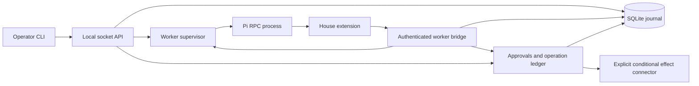

# Session service architecture

The operator API and private worker bridge share a service process. Pi runs in a separately supervised process, with a managed agent directory, explicit session identity, pinned house extension, builtin execution tools and MCP disabled, and one offline provider route.

Pi owns the conversation tree. Salaam imports read-only entries, cursors and active-leaf references after a turn settles. Salaam owns session lifecycle, accepted inputs, attempts, controller leases, approvals, operations/receipts, request responses, artifact references and ordered durable events. It does not maintain an independently editable model transcript.

## Readiness and grants

Each start allocates a new durable epoch. The worker receives a fresh private credential and context nonce. Its manifest must match the service's protocol, package/extension bundle digest, policy digest, session identities, capability set, tool set and provider route. A subsequent RPC state query confirms the actual Pi session path and selected model.

No prompt is dispatched until readiness commits. Every provider admission validates the actual outgoing task-context frame. Every tool checks policy, and the tool implementation obtains its own service grant before reporting success. Nested tool failures invalidate readiness. A manifest claim alone does not supply isolation: the house extension and pinned bundle are trusted code, with runtime failure tests covering those boundaries.

The bridge compares worker credentials and epochs. A persistence failure prevents a grant and revokes readiness in memory even if the unhealthy state cannot be written. The operator's inspection includes that live failure, so a stale persisted `ready` row cannot mask the denial.

## Persistence and delivery

SQLite transactions include both the mutation and its event. Durable request IDs return saved responses after retries, even if the original revision has advanced. SSE subscribes to commit notifications and catches up from the database; client connections never own worker lifetimes.

The client outbox flushes an instruction and stable request ID before sending. A lost acceptance response leaves the original record intact. Reattachment retries that logical request, even with a new controller credential. Cache lookup precedes lease/revision checks. A definite revision rejection permits rewriting the pending revision; unknown outcomes do not. Definitively invalid records are retained separately for inspection.

One controller lease permits new input and cancellation. Approval authority is separate: any authorized client of the trusted OS account can decide, including an observer attachment. Lease acquisition/release/takeover advances a controller epoch, renewals retain it, and service recovery revokes all leases. Takeover does not stop an active prompt. Leases coordinate trusted clients and do not isolate applications running as the same OS user.

The dispatcher is independent of attachments and runs one attempt per session. Its states are `accepted → dispatching → running → completed/failed/interrupted/cancelled`. The service commits `dispatching` before writing the Pi prompt. Pi's `started` disposition is acceptance into a run, not proof of completion. A settled run, actual error outcomes and transcript collection determine the attempt result. Transcript import and completion share one transaction so a snapshot cannot expose a completed answer ahead of its completion event. A completed turn is not proof of success for an external operation.

Snapshot projection follows the imported active leaf and bounds history and text. SSE replays committed events from that snapshot's cursor, handles socket backpressure and disconnects a persistently stalled consumer. Volatile previews have no event ID; the terminal renders committed results and does not use preview text as a recovery record.

Artifacts are written, flushed and renamed before their references commit. Their content digest is checked on read. SQLite and Pi JSONL remain separate persistence domains; these tests establish process-crash behavior, not universal host-loss recovery.

The service lifetime lock is held by a separate SQLite rollback-journal connection. This remains locked even while ordinary journal transactions commit, and the OS releases it when the process dies. The service keeps that lock handle reachable until shutdown.

## Process recovery

Pi processes get their own process groups and a name containing the session, epoch and unique service boot ID. The service records process identity before considering the worker ready. On restart it inspects that identity before signalling an old group. An unrelated reused PID is not signalled. If a previous writer cannot be proven stopped, recovery blocks the session rather than risking a second writer.

Workers also stop after bridge loss. Recovery does not adopt a live worker after supervisor death or replay unknown prompts. Once old workers are fenced, `dispatching`/`running` attempts become `interrupted`; `accepted` attempts remain queued. This includes the gap before a pipe write and the gap after Pi settles but before SQLite completion commits. Pi JSONL and SQLite cannot atomically acknowledge a prompt, so uncertainty is preserved rather than inferred away. Empty Pi sessions may not yet have a JSONL file; they retain their explicit session ID when restarted. A missing transcript with recorded model activity is an integrity failure.

Ordinary worker stop, service stop and client disconnection are different lifetimes. The detached service outlives its launcher and attachments. Ctrl-C/Ctrl-D detaches; shutdown stops workers and records active interruptions before closing the journal. `resume` provisions the recorded session and permits safe queued dispatch after readiness. An unresolved interrupted attempt blocks the queue. Explicit continuation creates a new attempt with new instruction text, links it to the interrupted attempt and takes priority over prior queued work. A failed worker can be replaced only after all prior writers are proven exited, with full readiness in a new epoch. Uncertain process ownership remains blocked.

## Approvals and effects

Preparation creates an immutable operation binding and a pending approval together. The binding covers session, attempt, worker epoch, tool-call lineage, server-generated action key, normalized argument digest, target/version, policy and connector. Reusing an invocation with different arguments conflicts. A distinct call gets a distinct key; model-supplied text cannot choose a previous key.

Approvals have their own revision, authorized operator scope and durable deadline. Decisions are request-deduplicated before checking stale preconditions, then committed before notifying Pi. No transaction or session lock remains held while waiting for a human. Default expiry is five minutes; the adapter has no independent dialog/turn timer that silently overrides it.

The house tool creates the durable approval before calling Pi confirm. A unique marker carries approval ID and digest; the supervisor persists the mapping to worker epoch and Pi request ID. Labels never route decisions. Bare confirm replies are presentation only: the operation dispatcher still checks the ledger. Worker loss invalidates old dialogs and prepared authority. A cached old decision response is historical evidence and cannot authorize a replacement invocation.

The service owns effect transport. States are `prepared`, `dispatching`, `succeeded`, `failed_definite`, `outcome_unknown` and `cancelled_before_dispatch`. After approval, target preflight runs without a database lock. Immediately before dispatch, the service rechecks the active invocation, approval/deadline, policy, binding, connector and unresolved-operation gate, then commits `dispatching`. The external conditional write closes the target-version race. The fixture connector's lookup mode sends the stable key; opaque mode supplies no idempotency/lookup guarantee.

Receipt validation binds the accepted payload and action key before a success commit. Connection failure after dispatch is unknown, never definite failure. Recovery fences old workers, cancels undispatched prepared operations and marks in-flight operations unknown, then performs read-only status lookup. A positive bound receipt resolves success. Not-found, unavailable lookup, changed connector or mismatched receipt cannot prove nonexecution, so the session remains blocked. Reconciliation never reissues an effect. An explicit operator resolution records its evidence and provenance separately from verified receipts.

Cancellation commits its request, revokes new grants, invalidates pending authority, cancels prepared operations and preserves unknown dispatched outcomes. Pi abort and owned transport abort happen afterward. Already accepted external work may continue. Shutdown drains dispatch, effect transport, lookups and outstanding request handlers before closing SQLite. This includes a target-version preflight still awaiting its connector.

The shipped connector targets an explicit local fixture protocol, not arbitrary production APIs. It uses conditional writes and optional key lookup; shell execution, live model accounts, production isolation and durable task verification remain outside this evidence.

## Child lifecycle and usage

Schema v4 adds child tasks, per-attempt request budgets and immutable usage sources. The service commits a new child session, its initial submission/attempt, its reserved budget and its parent step-key binding in one transaction, then provisions a separate supervised Pi process. Each child owns its own transcript and worker epoch. The manifest's tool inventory is reduced to the granted read-only probe; implementation bridge routes also reject child operation dispatch. Maximum depth is one and active concurrency is two per parent session.

Completed, failed, cancelled and interrupted children publish the same fixed result envelope. Bytes are fsynced before a transaction commits the attempt outcome, child final state, artifact reference and parent `child.result_available` event. An unreferenced file after rollback/crash has no delivery authority. Consuming returns the stable result and does not mutate delivery state; explicit acknowledgment commits its own idempotent event. Parent replacement resumes the same inbox. Parent death does not own child process lifetime; service death fences every writer and explicitly interrupts unfinished children without replay. Parent cancellation records child cancellation intent in the same transaction and aborts the relevant processes afterward.

Each parent attempt has a fixed 16-request budget. Child reservations are subtracted before launch; each admission consumes its own allocated request. Reservations are retained, including after uncertain usage, and cannot be reclaimed to fund a duplicate child. These bounds do not claim token or currency limits. New continuation attempts get new parent budgets while old step keys remain bound to their original children.

Provider admission first journals an unknown observation with a generated source key. The fixture provider commits its usage receipt before delivering its final response to Pi; the response carries that source key into the transcript. Importing the same assistant entry joins the existing source instead of adding another amount. Raw Pi entries without request IDs use session/entry keys. Conflicting receipts fail closed. Auxiliary usage, compaction and branch-summary receipts use entry keys; missing/error receipts stay unknown. Pi pricing estimates are labelled separately from known fixture costs. Aggregation sums actual provider observations in each session of the tree; it never sums child aggregate amounts embedded in tool messages. Real compaction and live Anthropic forwarding remain unproved until their separate integration work.
