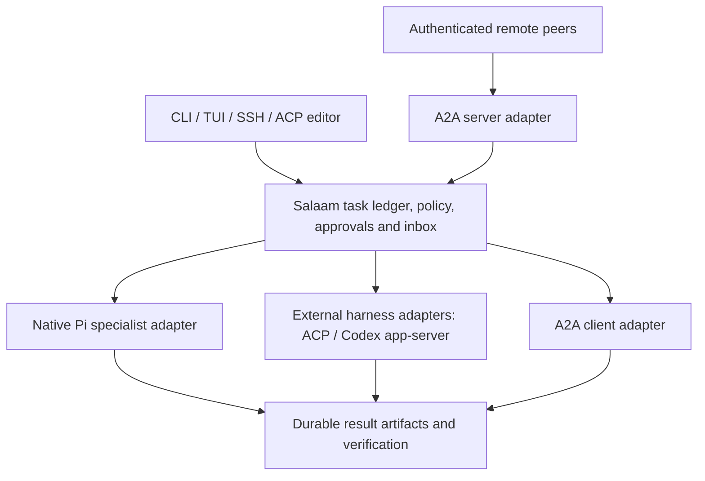

# Multi-agent implementation plan: M13–M18

Planning date: 2026-10-18. M13 native profiles, repository readers and reviewer findings, plus M14 task-step claims and passive team messaging, are implemented on the development branch with offline proofs; see the [worker admission boundary](worker-boundary.md). M15 private coding drafts, explicit integration and recovery receipts also have an implementation and real local Docker rehearsal; see [native coding workers](worker-workspaces.md). Live usefulness/comparison, independent Linux evidence and the remaining M16–M18 exit gates are outstanding. All six milestones are being developed in one PR. Terminal interaction and unattended remote work remain equal priorities. This is contributor planning material and stays outside the public docs site's allowlist, search, and machine-readable exports. No delivery dates are assigned.

The product outcome is concrete: ask Salaam to investigate, implement, and review a repository change using native specialists, a named external coding harness, and a remote A2A specialist. Disconnect and restart the daemon, then recover the same work identities, inspect the actual patches and checks, resolve any approvals, and finish without duplicate dispatch or falsely verified success.

## Baseline and prerequisites

The source baseline is `da29b7997e7acf039d8a4d17114f34df6340b00d`, on the stack [provider support #6](https://github.com/SuperJackfruitLabs/salaam/pull/6) → [optional token budgets #7](https://github.com/SuperJackfruitLabs/salaam/pull/7). These PRs require their own review and CI; the plan does not imply that they are merged, released, or deployed. The combined local implementation passed 1,993 offline tests before the commit split; the provider-only boundary passed 1,723 targeted tests. Build/platform/live acceptance remain separate evidence layers.

- Existing M6 child work has separate Pi processes, stable spawn/result IDs, durable result acknowledgement, request reservations, scoped cancellation, and conservative restart behavior. Children currently have only `salaam_probe`, inherit one provider/model route, and cannot delegate further. They are not useful repository specialists yet. See [child implementation](../../src/children.ts) and [tool inventory](../../src/protocol.ts).
- M9 provides owned workspace copies and a proven command executor. M11 provides task/step state, verification, checkpoints, and bounded progression. M12 provides jobs, recurring occurrences, and an operator inbox. Extend these records rather than introducing a second competing task scheduler or result store.
- `sal acp` is currently an agent-side adapter used by editors. It is not an outbound ACP client that controls another harness. There is no A2A adapter in this baseline.
- Token budgeting remains capped by default. The explicit `limits.token_units: null` choice preserves the other supported controls. This choice does not make an opaque worker's internal model-request count observable or enforceable.

## Patterns selected from the research

These are documentation/source observations as of the planning date, not tests of deployed peer versions.

| Reference                                                                                                                                                                                               | Pattern to adopt                                                                                                                                      | Boundary to preserve                                                                                                                                                                                  |
| ------------------------------------------------------------------------------------------------------------------------------------------------------------------------------------------------------- | ----------------------------------------------------------------------------------------------------------------------------------------------------- | ----------------------------------------------------------------------------------------------------------------------------------------------------------------------------------------------------- |
| [Claude Code subagents](https://code.claude.com/docs/en/sub-agents) and [teams](https://code.claude.com/docs/en/agent-teams)                                                                            | Named specialists, focused context, explicit tool/model policy, isolated implementation work, inspectable team activity                               | Separate conversations do not isolate files. Team messaging and a model's completion claim do not verify a patch.                                                                                     |
| [Codex subagents](https://learn.chatgpt.com/docs/agent-configuration/subagents)                                                                                                                         | Visible worker threads, steer/stop/follow-up controls, parallel exploration and review                                                                | Concurrent writers need workspace ownership and integration rules, not just additional model calls.                                                                                                   |
| [OpenCode agents](https://opencode.ai/docs/agents/)                                                                                                                                                     | Project-defined profiles, understandable permissions, quick parent/child navigation                                                                   | A profile cannot grant itself more authority than the operator admitted.                                                                                                                              |
| [Pi subagent extension](https://github.com/badlogic/pi-subagent)                                                                                                                                        | Persistent worker handles, provider/model selection, direct inspection and follow-ups                                                                 | Do not import an uncontrolled extension lifecycle or edit Pi JSONL. Salaam remains the owner of dispatch and recovery.                                                                                |
| [OpenClaw routing](https://docs.openclaw.ai/concepts/multi-agent), [ACP runtimes](https://docs.openclaw.ai/tools/acp-agents), and [Swarm](https://docs.openclaw.ai/tools/swarm)                         | Separate agent identity from runtime; explicit external-harness adapters; bounded fan-out and structured collection                                   | Workspace paths are not sandboxes. Large fan-out and nested orchestration stay policy-bounded. A failed child remains visible in collection.                                                          |
| [Hermes delegation](https://hermes-agent.nousresearch.com/docs/user-guide/features/delegation) and [Kanban](https://hermes-agent.nousresearch.com/docs/user-guide/features/kanban)                      | Distinguish short delegated reasoning from durable assigned work; profiles, dependency graphs, observable handoffs, separate notification and wake-up | Recover ownership and uncertain effects before retrying. Neither a process restart nor a new assignee authorizes replay of an uncertain action.                                                       |
| [Gemini ACP](https://geminicli.com/docs/cli/acp-mode/) and [remote agents](https://geminicli.com/docs/core/remote-agents/)                                                                              | A common local/remote specialist experience backed by explicit protocol adapters                                                                      | Pin and test the actual executable, launch flags, protocol version, and capability set; examples are not compatibility evidence.                                                                      |
| [A2A 1.0](https://a2a-protocol.org/v1.0.0/specification/), [Hermes A2A](https://hermes-agent.nousresearch.com/docs/user-guide/messaging/a2a), and [OpenClaw A2A](https://docs.openclaw.ai/channels/a2a) | Agent Cards, authenticated peer identity, task/artifact mapping, capability-based polling or streaming                                                | OpenClaw currently documents memory-only A2A task retention and no streaming/cancellation. Hermes documents a broader surface. Capability and durability tests must cover each named peer separately. |

## Architecture and contract decisions to prove first

The Salaam daemon remains the single admission and ownership authority. A runtime adapter translates operations; it does not gain a second scheduler, its own approval authority, or permission to retry unknown work.

M13.1 must define and test these proposed contracts before enabling broader child tools:

1. **Identity and ownership:** keep profile ID/revision/digest, worker ID/runtime, owner session/task, logical request/step key, attempt ID, and execution generation distinct. An upstream harness session ID or A2A task/context ID is an owned mapping, never local authority. Profile names, titles, remote message roles, and notification text cannot authenticate an operator.
2. **Frozen admission:** bind the input artifact, profile/tool policy, provider/model or harness/peer, capability digest, workspace snapshot, executor/configuration, and bounds. Reconfiguration affects a new admitted attempt; it cannot silently retarget a queued or active one. Credentials are references to separately scoped auth, never profile contents, model context, or journal payloads.
3. **Lifecycle:** persist intent before dispatch, then upstream acceptance, status, artifacts, and delivery/acknowledgement separately. Admitted, running, interrupted, outcome-unknown, failed, and verified success must remain distinguishable. A delivered completion is not proof that the parent processed it. Same-key retries return the saved binding before new revision/lease checks.
4. **Adapter surface:** discover/prove capabilities; prepare; dispatch; inspect/reconcile; stream or poll; request cancellation; retrieve results; explicitly continue/follow up. Capabilities cover resume, confirmed stop, file/command authority, isolation, model-request metering, output caps, usage receipts, and task retention. Unsupported operations fail explicitly.
5. **Budget scope:** preserve native `limits.requests` as model-request admission, not prompts or remote calls. Introduce a separate, explicit invocation-bounded assignment policy for opaque runtimes, with its own counter and visible unknown internal model usage. Existing model-budgeted work must reject such an adapter unless it can prove enforcement. Choosing invocation bounds requires an operator grant; the current token-budget opt-out alone is insufficient. This proposed policy extension is reviewed with the M13.1 contract, not inferred from a protocol response.
6. **Compatibility:** additive migrations preserve existing tasks, cached replies, approvals, usage, legacy child IDs, and result acknowledgements. Keep current native defaults of depth one and two active children until explicitly changed through policy. Publish versioned fixture contracts and document old-client/unknown-field behavior; never rewrite Pi transcripts.

The implementation impact map is explicit:

| Producer or owner                                                                           | Consumers to update together                                                             | Conformance evidence                                                                                   |
| ------------------------------------------------------------------------------------------- | ---------------------------------------------------------------------------------------- | ------------------------------------------------------------------------------------------------------ |
| `children.ts`, `store.ts`, `protocol.ts`: worker/profile/attempt ownership and migrations   | Legacy child API, task driver, native/runtime adapters, snapshot/event readers           | Upgrade legacy state; retry saved requests; reject wrong owner and stale generation                    |
| `supervisor.ts`, house extension and provider admission: per-worker route/capability grants | Child auth resolution, model/tool admission, task budgets and displayed capability state | Different admitted child providers; isolated credentials; capability/profile changes deny fresh grants |
| `task-work.ts`, `task-driver.ts`, `task-budget.ts`: assignments, claims, bounds and results | Jobs/schedules, operator inbox, verification and integration                             | One claim per attempt, root-wide reservations, no replay of uncertain work, fresh checks               |
| New harness/A2A adapters: upstream serialization and acceptance mapping                     | Remote peer/harness and the same local task/result ledger                                | Independently versioned protocol fixtures, malformed/unsupported cases, named live acceptance          |
| `service.ts` API/events                                                                     | CLI, TUI and editor-facing `acp.ts`                                                      | Same state/IDs across surfaces, lost-reply deduplication and no approval amplification                 |

No cross-product SJL identity agreement or consumer conformance is established by this plan. Salaam owns the local producer/schema; CLI/TUI/editor views and runtime adapters are its consumers. External protocol compliance and live peer operation require independent evidence.

## Milestone map

| Milestone                                     | User-visible outcome                                                                                          | Dependency                                  | Exit gate                                                                                                  |
| --------------------------------------------- | ------------------------------------------------------------------------------------------------------------- | ------------------------------------------- | ---------------------------------------------------------------------------------------------------------- |
| M13 — Native specialists and worker contracts | Explorer and reviewer children can perform useful, bounded repository analysis                                | Reviewed #6/#7 baseline                     | Authority/recovery proof first; real read/search evidence with zero child writes                           |
| M14 — Durable teams and coordination          | Named workers exchange scoped messages and execute a bounded dependency graph                                 | M13                                         | Crashes and duplicate delivery cannot duplicate claims, work, or accepted results                          |
| M15 — Parallel coding and integration         | Workers implement independent changes in isolated copies; an integrator verifies and applies accepted patches | M13; M14 for coordinated parallel execution | Real isolated commands, dirty-work preservation, conflict rejection, fresh combined verification           |
| M16 — External harness workers                | Salaam controls a pinned external coding harness with the same inspection and policy vocabulary               | M13; M15 before write-enabled acceptance    | Real harness readiness, loss/reconnect/approval behavior, execution boundary, honest budget capabilities   |
| M17 — A2A federation                          | Salaam calls remote specialists and exposes selected work to authenticated peers                              | M13; M14 for durable routing/wakes          | Independent SDK plus pinned Hermes/OpenClaw interoperability; peer loss never causes blind resubmission    |
| M18 — Mixed-runtime acceptance and release    | One local/remote workflow combines native, harness, and A2A workers across disconnect/restart                 | M13–M17                                     | Source-bound macOS/Linux evidence, no duplicate effects, verified integrated result, accurate CLI/TUI/docs |

Every implementation slice includes its CLI/API surface, TUI status/inspection, migration tests, and documentation of actual limitations. Richer team views and the complete operator rehearsal follow in M14/M18; clients read the same daemon records throughout.

## M13 — Native specialists and worker contracts

| Slice                                             | Concrete change                                                                                                                                                                                                                                                            | Required proof                                                                                                                                                                                                                              |
| ------------------------------------------------- | -------------------------------------------------------------------------------------------------------------------------------------------------------------------------------------------------------------------------------------------------------------------------- | ------------------------------------------------------------------------------------------------------------------------------------------------------------------------------------------------------------------------------------------- |
| M13.1 — Admission, identity and recovery boundary | Versioned worker/capability records and adapter fixtures; migrate legacy children without changing their authority. Freeze profile/configuration and distinguish model-request from invocation bounds. Keep diagnostic tools only in this slice.                           | Kill before/after intent and acceptance; lose a reply; replay a saved request under an expired lease; revoke a profile or change capabilities. No duplicate execution, wrong owner, new tool grant, or stale-generation write.              |
| M13.2 — Specialist profiles                       | Discover proposed `.salaam/agents/*.md` definitions as data: name/description, prompt, native provider/model preference, tool allowlist, context policy, and bounds. Validate and show effective policy before admission. Add proposed `sal agents list/inspect` commands. | Project/model-written definitions cannot add executables, credentials, plugins, network permission, or broader tools. A changed digest fences old grants instead of mutating running workers.                                               |
| M13.3 — Explorer                                  | Give explicitly admitted explorer children real bounded file read/list/search over the exact reviewed workspace revision. Supply a focused goal, selected facts and artifact references rather than the whole parent transcript.                                           | Discover known symbols and return actual file/line evidence. Attempts to write, execute, follow escaping symlinks, or read credentials/control metadata fail before access. Parent-only prompt data is absent unless deliberately supplied. |
| M13.4 — Reviewer and result handoff               | Add a reviewer profile over an immutable diff/base snapshot; typed findings and evidence artifacts; selected-provider auth per child, enabling a different admitted model/provider.                                                                                        | A reviewer identifies seeded defects, cannot modify files or claim stale evidence as current, and returns one stable result across parent death and lost acknowledgement. The operator can inspect that same worker/result in CLI/TUI.      |

**M13 exit:** a native parent uses an explorer and an independent reviewer on a fixture repository, with real evidence, different admitted model routes, reconnect, and parent/daemon failure. Deterministic providers prove control and data flow; a separately budgeted live run establishes only observed model usefulness. No editing children or automatic recursive delegation yet.

## M14 — Durable teams and coordination

| Slice                                       | Concrete change                                                                                                                                                                                                                                             | Required proof                                                                                                                                                                                                           |
| ------------------------------------------- | ----------------------------------------------------------------------------------------------------------------------------------------------------------------------------------------------------------------------------------------------------------- | ------------------------------------------------------------------------------------------------------------------------------------------------------------------------------------------------------------------------ |
| M14.1 — Teams, assignments and task claims  | Assign named profiles to existing task/step identities; add bounded dependency fan-out and a single-owner claim/generation. Support explicit blocked, awaiting-review and infrastructure wait reasons.                                                      | Two claimants and restart cannot own the same assignment. Dependency cycles and excessive fan-out are rejected. A stale claimant cannot attach results, verify, or complete the newer attempt.                           |
| M14.2 — Durable messages and wake-up        | Persist sender/recipient ownership, message ID, correlation, artifact refs and delivery/ack state. Separate passive notification, explicitly authorized follow-up/wake, and operator approval.                                                              | Duplicate/out-of-order delivery, a missing destination, full queue, and death after delivery acceptance retain accurate state. A peer/child message cannot manufacture a human instruction or approval.                  |
| M14.3 — Bounds, scheduling and cancellation | Root-task request reservations or explicit invocation bounds, separate daemon/root/profile concurrency ceilings, deadlines, queue backpressure and ownership-tree cancellation. Optional nested delegation is restricted to admitted orchestrator profiles. | Nested workers cannot mint new root allowances or bypass depth/tool policy. Cancellation revokes queued work first; uncertain running work retains its slot/uncertainty until reconciled. Unrelated teams remain active. |
| M14.4 — Team operator experience            | TUI team tree and task board; profile/runtime/model, current owner, dependencies, messages, checks, usage certainty and stop state. CLI list/inspect/message/follow-up/stop and editor metadata use the same records.                                       | Real PTY plus API tests cover detach, takeover, a lost mutation response, scoped steering and reconnect without duplicated text, work, or decisions.                                                                     |

**M14 exit:** two native workers complete independent predecessor tasks, hand results to a synthesizer, and preserve ownership and delivery across worker/daemon death. A model cannot set a failed check to passing or complete an unrelated task. Short-lived child calls and durable assigned work have distinct UX but share the same ownership/result infrastructure.

## M15 — Parallel coding and integration

| Slice                                | Concrete change                                                                                                                                                                                                                              | Required proof                                                                                                                                                                                                                                |
| ------------------------------------ | -------------------------------------------------------------------------------------------------------------------------------------------------------------------------------------------------------------------------------------------- | --------------------------------------------------------------------------------------------------------------------------------------------------------------------------------------------------------------------------------------------- |
| M15.1 — Reviewed workspace snapshots | Branch each writing worker from the same exact owned snapshot, including pre-existing dirty bytes; use copy/worktree implementation only behind the proven execution boundary. Keep the original checkout and service metadata inaccessible. | Two simultaneous workers cannot modify each other, the parent workspace, host credentials, or control sockets. A Git worktree by itself never satisfies the isolation check.                                                                  |
| M15.2 — Builder and test workers     | Scoped patch/command authority, stable command IDs/logs, read-only review/test roles where appropriate, and per-worker artifacts. Install/pin dependencies outside model turns.                                                              | Real isolated tests fail before repair and pass afterward. Worker/daemon loss retains command identity and uncertainty; reconnect does not rerun a command. Cancellation stops only owned work.                                               |
| M15.3 — Integration receipts         | Export base/diff digests and patch artifacts. Only an integrator with an explicit application grant applies them to the parent owned workspace, using conflict detection and fresh combined verification.                                    | Disjoint changes integrate once. Overlap, changed base, stale check, human edits and failed combined tests block completion without overwriting bytes or retrying effects. External Git push/PR actions retain separate authority.            |
| M15.4 — Parallel coding portfolio    | Versioned discovery/review, disjoint edits, conflicting edits, dependency handoff, failing-test repair and dirty-work tasks, with actual hidden assertions.                                                                                  | Compare applicable cases against single-agent execution under recorded equivalent bounds. Report correctness, latency, model requests, usage certainty, coordination cost and human interventions; do not assume more agents improve results. |

**M15 exit:** two writing workers and an independent reviewer deliver one verified change through the integrator on the supported real execution backends. Human changes survive every tested crash and conflict boundary.

## M16 — External harness workers

| Slice                                              | Concrete change                                                                                                                                                                                                                                                                                                                 | Required proof                                                                                                                                                                                                                                                                        |
| -------------------------------------------------- | ------------------------------------------------------------------------------------------------------------------------------------------------------------------------------------------------------------------------------------------------------------------------------------------------------------------------------- | ------------------------------------------------------------------------------------------------------------------------------------------------------------------------------------------------------------------------------------------------------------------------------------- |
| M16.1 — Outbound ACP capability spike              | Build a daemon-owned ACP client, distinct from the existing editor-facing adapter. Pin the protocol subset, executable/adapter version and launch configuration. First target: Gemini CLI's documented stdio ACP mode; verify the actual launch flag and supported methods on the selected version.                             | Independent fake agent checks framing, negotiation, malformed output, unsupported resume/cancel, timeout and unavailable authentication. Record whether model requests/output caps are actually controllable. Reject incompatible task policies rather than relabeling prompt counts. |
| M16.2 — Guarded external execution                 | Route filesystem/terminal operations through Salaam's proven boundary or isolate the entire harness with an explicitly proven credential/network design. Pin selected auth scope and exclude unrelated host config, plugins, credentials and service control.                                                                   | Real read/write/command probes cannot escape the workspace or approvals. A harness's own tools cannot bypass the client-side proxy. Until this boundary passes, the adapter has no write/exec capability.                                                                             |
| M16.3 — Durable lifecycle and approval translation | Map local request/attempt to the owned harness session and acceptance receipt. Persist permission requests with concrete action/scope; distinguish append-follow-up, interrupt, reconnect and explicit continuation.                                                                                                            | Death around acceptance, permission delivery/decision, terminal receipt and tool return does not create a second prompt or grant. If upstream acceptance or execution cannot be recovered, report unknown and require explicit resolution.                                            |
| M16.4 — Codex app-server adapter                   | Add a separate pinned stdio adapter for Codex thread/turn lifecycle, approval requests, inspection and interrupt/resume. Bind both thread and turn IDs to the local attempt; do not infer them from titles or assume ACP wire compatibility. Use the [official app-server contract](https://learn.chatgpt.com/docs/app-server). | Independent protocol fixtures and a real pinned executable cover lost acceptance, account/token renewal, owned-thread resume, unsupported controls and duplicate terminal events. Enforce the same execution/credential boundary and budget admission as ACP.                         |
| M16.5 — Named harness acceptance                   | Complete Gemini CLI ACP, a named Claude Code ACP-adapter target, and Codex app-server, each with exact versions, conformance fixtures and an independently recorded capability matrix. Use the shared TUI/CLI worker views.                                                                                                     | Each performs a bounded real repository task, separate approve/deny decisions and same-owned-session reconnect. Where a control is unavailable, the UI and admission reject it.                                                                                                       |

**M16 exit:** three named external harness paths are supported within their observed scope. Explicit invocation-bounded work may proceed when internal model metering is unavailable; default model-budgeted work remains rejected. Executable or adapter upgrades require renewed capability/boundary evidence. No plugin download or installation occurs during a worker turn.

## M17 — A2A federation

| Slice                                         | Concrete change                                                                                                                                                                                                                                                                                          | Required proof                                                                                                                                                                                                                                                   |
| --------------------------------------------- | -------------------------------------------------------------------------------------------------------------------------------------------------------------------------------------------------------------------------------------------------------------------------------------------------------- | ---------------------------------------------------------------------------------------------------------------------------------------------------------------------------------------------------------------------------------------------------------------- |
| M17.1 — Versioned peer and ownership contract | Pin A2A specification 1.0.0 (wire version 1.0), SDK version and JSON-RPC transport. Operator-configured peer registry binds endpoint, authenticated identity, allowed skills, data scope, capability/retention claims and budget policy.                                                                 | Wrong version/tenant/peer, unknown capability, malicious Agent Card URLs, redirects and cross-peer task/context IDs fail without forwarding credentials or starting work. Capability changes require renewed admission; no silent 0.3 downgrade.                 |
| M17.2 — Outbound delegation                   | Persist local dispatch intent plus message ID and the remote task/context mapping. Start with bounded text/structured-result tasks, GetTask polling and artifact import; add streaming as a negotiated capability.                                                                                       | Lose the acceptance reply and connection before/after remote work. Reconcile the same task where possible. A peer restart/expired task or unsupported dedup guarantee yields unknown rather than a fresh send. Local deadlines do not imply remote work stopped. |
| M17.3 — Inbound service adapter               | Expose selected Salaam profiles/skills through an Agent Card and authenticated endpoint, private by default; remote exposure requires an explicit listener/TLS or tunnel configuration. Use explicit peer-to-profile/workspace grants, per-peer dedup/rate bounds and the existing task/approval ledger. | Duplicate message IDs cannot create duplicate work; changed content conflicts. A remote `ROLE_USER`, slash command, profile name or task title cannot act as the human operator or decide an approval. Client loss preserves accepted work and access isolation. |
| M17.4 — Stream, cancel and resume semantics   | Map status/artifact identities, input/auth-required states, polling/SSE reconnect, requested versus confirmed stop, and delivery acknowledgements. Bind human decisions to existing approval identities.                                                                                                 | Reordered/duplicate events cannot duplicate artifacts or regress terminal state. Dropped streams reconcile a snapshot. Unsupported cancellation is reported as unsupported, not cancelled. Remote success still requires configured local acceptance checks.     |
| M17.5 — Independent interoperability          | Exercise the official SDK plus pinned Hermes and OpenClaw releases in both supported directions. Freeze their manifests/cards and record the actual tested methods, retention, auth and transport.                                                                                                       | Hermes exercises richer streaming/task behavior where observed; OpenClaw exercises the polling/minimal-capability path and memory-only task-loss case. Neither an SDK fixture nor advertised Agent Card is presented as proof that the other peer/version works. |

**M17 exit:** one remote specialist is callable from Salaam and one authorized external peer can submit work to Salaam. Audit the disclosure of prompts, files/artifacts, credentials and result metadata per peer. Token budgets and internal model-request limits are enforced only where proven; otherwise require the explicit invocation-bounded policy. Keep remote results untrusted and preserve unknown outcomes through restart.

## M18 — Mixed-runtime acceptance and release

1. **M18.1 — Combined scenario:** a native explorer produces evidence, an external harness implements an isolated change, a native reviewer and a remote A2A specialist review it, and the integrator runs fresh checks. Run with a macOS terminal/ACP client and a named Linux execution host. Disconnect, take over, stop a selected worker, and answer an approval through the shared inbox.
2. **M18.2 — Crash and authority portfolio:** barriers before/after local intent, remote acceptance, tool side effect, result persistence, acknowledgement and integration. Repeat duplicate triggers/messages, parent and daemon SIGKILL, peer restart, storage failure, profile/credential/capability changes, stale claims, cancellation races and conflicting human edits. Check real counters/receipts/files, not model summaries. Preserve all S1–S6 and M9–M12 regressions.
3. **M18.3 — Capability-gated release:** record source/build/runtime/adapter/protocol/model/backend identities and the evidence for each supported combination. Validate installed CLI packages and real PTYs, publish user guides only for implemented capabilities, and keep plans/maintenance internals out of the public site. Release and deployment remain separately authorized actions.

The default suite uses disposable offline agents, fake ACP/A2A peers and deterministic providers. Live-model usefulness tests need a separately approved request/output/cost scope; real peer and execution tests need named provisioned hosts and releases. A fixture pass never substitutes for live interoperation, execution isolation, or power-loss durability.

## Sequencing and first implementation PR

Implement **M13.1 → M13.2 → M13.3 → M13.4** first. The first PR must prove durable worker identity/admission and rejection paths while retaining current diagnostic-only tools; broader coding tools follow the boundary proof.

After M13, M14 coordination, M16.1 ACP and M17.1–M17.2 A2A read-only integration can progress as separate reviewable tracks. M15.1–M15.2 may develop against M13; M15.3 coordinated integration requires M14. External write/exec acceptance additionally requires M15's isolation and integration rules. M17.3 inbound job routing/wakes uses M14. M18 begins only after each adapter's named exit gates pass.

At every slice, migrate and test producer/schema plus CLI/TUI/editor/adapter consumers together. Keep proposed fields separate from shipping contracts, attach source-bound evidence to the PR, and revise the capability matrix when a target fails a proof instead of claiming the protocol guarantees it.
