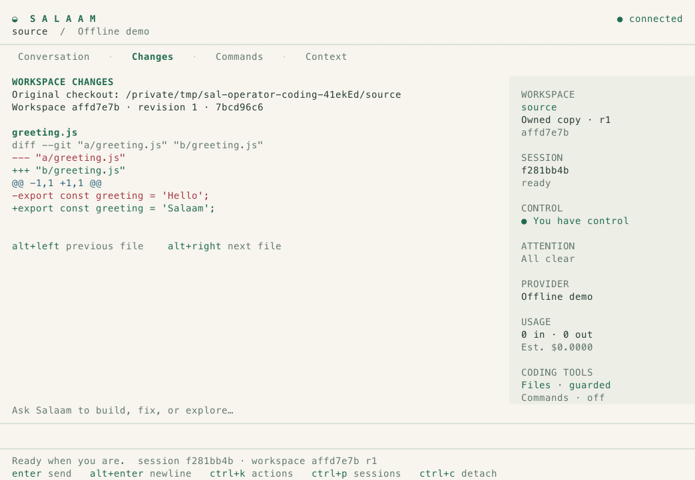
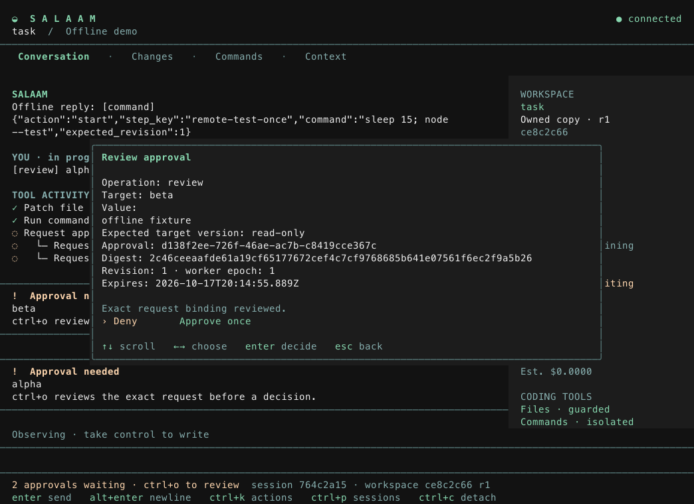

# Local verification

Verified on **2026-10-17**, on macOS arm64 with Node **26.7.0** and npm **11.19.0**. Historical foundation and Claude-route records are retained below; M9 and M10 evidence is recorded at the end.

| Check                     | Observed result                                                                                                                                                                                                          |
| ------------------------- | ------------------------------------------------------------------------------------------------------------------------------------------------------------------------------------------------------------------------ |
| Runtime/dependencies      | Exact Node, npm and Pi pins retained; dependency lockfile unchanged from M0–M2                                                                                                                                           |
| Formatting/type check     | `npm run format:check` and `npm run check` passed                                                                                                                                                                        |
| Final combined suite      | **101 tests passed**, no failures: all five S4 recovery/authority scenarios repeated three times, plus 86 other checks including 18 S6 readiness cases                                                                   |
| Default suite             | 91 cases with repetition disabled; the earlier 87-case intermediate M6 run also passed                                                                                                                                   |
| Managed proofs            | All 20 S2/S3 scenarios passed in the final suite. The M4–M5 baseline separately passed these scenarios three times (118 total tests)                                                                                     |
| Child recovery            | Parent death preserved both independent children; replacement workers reused original spawn keys and result IDs. Service death retained completed artifacts and explicitly interrupted unfinished children               |
| Inbox delivery            | Kill after result read and before acknowledgment preserved the same artifact. Repeated acknowledgments emitted no duplicate acknowledgment event                                                                         |
| Authority and budgets     | Child depth/concurrency and read-only intersection enforced; direct effect-bridge bypass denied before connector preflight. Parent reservations and child admission rejected over-budget dispatch                        |
| Usage                     | Stable request/Pi-entry imports deduplicated; nested tool totals ignored. Known/estimated/unknown amounts stayed distinct. Death before usage commit left null amounts and an explicit unknown count across two restarts |
| Atomic child publication  | Injected result-event storage failure rolled back the attempt outcome, artifact reference, child state and inbox event together. Worker loss before initial handoff published an interruption                            |
| Terminal death            | A killed CLI and reconnected observer shared one real Pi worker; one submission, attempt, user message and tool grant                                                                                                    |
| Lost responses            | Socket proxies dropped submission and decision responses; fresh outboxes recovered the original committed results without duplicating work                                                                               |
| Concurrent approvals      | Reverse decisions, two sessions, expiry, changed arguments/targets, worker replacement and unsolicited real Pi UI replies passed                                                                                         |
| Effect failure boundaries | Pre-intent rollback, prepared intent, dispatch before external acceptance, acceptance before receipt commit, receipt before tool return, worker/service death and cancellation passed                                    |
| Uncertainty               | Negative/unavailable lookup, mismatched receipts and opaque connectors remained unknown; no recovery path resent an effect. Explicit operator resolution retained its provenance                                         |
| Version race              | An intentionally stale preflight still met an external conditional-write rejection; no effect was accepted                                                                                                               |
| Persistence/protocol      | Schema-v1/v2/v3 upgrades retained cached replies and outcomes. Journal failure denied dispatch. Atomic transcript/completion, Unicode input, command FIFO ordering and large-event replay passed                         |
| Offline demos             | All three CLI demos passed against the final compiled bundle: session persistence, reverse approval/one effect, and two children with stable results, repeated acknowledgment and six unique provider requests           |
| Pi bundle verification    | Exact npm artifact, lockfile integrity and installed Pi package-content digests matched                                                                                                                                  |

The tested worker bundle digest is:

```text
d0c5afe72f313d5d7acf157491cf1879a665b30e46227bb58eacaf9e3b7b574d
```

The package pin is `@earendil-works/pi-coding-agent@1.3.0`. Its published RPC command reference matched the researched source commit byte for byte. No `gitHead` was supplied by the registry, so this evidence identifies the tested npm artifact without asserting full source-build equivalence.

Local reports are retained under `.state/evidence/` and excluded from Git: `m6-full-suite.json` (final 101-case run), `m6-pi-bundle.json`, `m6-session-demo.log`, `m6-managed-demo.log` and `m6-children-demo.log`. `m6-child-repeat.json` records an earlier successful 16-case child repeat/unit run. M0–M5 reports, including the 118-case M4–M5 result, remain historical evidence.

During M6 development, one new cancellation test initially checked the parent's final state immediately after its children aborted. The cancellation intent was already durable; parent completion is asynchronous. The test now waits for both final outcomes. The final repeated proof passed.

One earlier full run exceeded the S1 service-crash test deadline. Its report is retained as `m4-m5-timeout.json`; the exact cause was not established. The same S1 suite subsequently passed 35 cases across five runs, and the final combined suite passed. OS process-identity inspection now has a two-second subprocess deadline, and late bridge failures during intentional shutdown preserve stopped-worker state. These observations do not establish immunity to host scheduling or storage stalls.

## Reproduce

```sh
npm ci --ignore-scripts
npm run format:check
npm run check
mkdir -p .state/evidence
SALAAM_CHILD_REPETITIONS=3 npm test -- --reporter=json \
  --outputFile=.state/evidence/m6-full-suite.json
npm run verify:pi
npm run demo:session
npm run demo:managed
npm run demo:children
```

Local socket/process tests ran with host permissions because the execution sandbox denied socket creation. They used real pinned Pi with an offline provider and an independent durable local effect fixture. No live model account, fleet deployment or third-party production service was exercised. M3 was committed as `3ef8447` and pushed to `origin/m3-session-attach`. M4–M5 was committed as `dd95b6cd3c0a7e83d66ed6ad351577fd966f1430` and pushed to `origin/m4-m5-approvals-effects`; the remote head was verified. GitHub metadata previously confirmed that the Salaam repository was private. M6 was committed as `b80962890da209bbb8c013f3986b5ea41e07bf43` and pushed to `origin/m6-child-work-usage`; its remote head was verified. The Claude integration and installed CLI are recorded on `claude-live-provider`, based on that M6 commit.

S1–S4 and S6 have local offline/fixture evidence; S5 remains pending. Interrupted prompts and unknown effects are never automatically replayed. Cancellation does not undo already accepted external work. Operator resolutions are attestations, distinct from verified receipts. Exactly-once behavior for arbitrary services/shell commands, real provider routing, durable task facts, production process isolation and host-loss recovery remain outside this evidence. Linux CI is configured but has not been observed running in this local verification.

The M6 baseline checks above used no provider key and made no claim of successful Anthropic authentication or live forwarding. Request budgets are counts, not token or currency limits. The accounting unit fixture includes compaction entry imports; real compaction recovery remains M7.

## Claude route verification

The final combined suite passed **108 tests**, with no failures. Formatting, type checking, Pi package/content verification and all three existing CLI demos also passed. The Pi version and dependency lockfile are unchanged. The tested worker bundle digest is:

```text
43e415012257e8d89b6ee384ac72d103a0e42f6df7a5dd874d9d04cfa5183e7e
```

The ten Claude provider proofs use real pinned Pi and an independent local HTTP process emitting Anthropic-compatible SSE. Test-only extensions redirect the fixed upstream URL to that fixture; no production endpoint override is exposed. They cover text streaming, a managed tool round trip, Pi payload/header/response/stream callbacks, immutable usage import, authentication/rate-limit failure, dropped response, failed context/payload hooks, cancellation, child-route inheritance, service death/explicit continuation, and a denied usage-admission commit. HTTP and Pi turn retries are disabled. Error-body fixtures deliberately include a dummy credential and verify its absence from Pi transcripts, operator snapshots and worker stderr.

The detached CLI proof confirms forwarding of provider/model/output/workspace settings, rejects an already-running daemon with another route, checks public responses/logs exclude the dummy key, and rejects resuming a live session from an offline daemon. It provisions readiness without a provider request. Unit cases cover mode-600 storage/mode-700 directories, environment precedence, replacement, symlink refusal, missing-key/OAuth rejection, final-payload model/tool/context/output/fallback checks, and schema-v4 migration with immutable session routes. Readiness now has 21 cases, including provider/route mismatch and refusal to proceed when retry/compaction controls cannot be configured.

Reports are ignored local files under `.state/evidence/`: `claude-full-suite.json`, `claude-pi-bundle.json`, `claude-session-demo.log`, `claude-managed-demo.log` and `claude-children-demo.log`. Reproduce with:

```sh
npm run format:check
npm run check
npm test -- --reporter=json --outputFile=.state/evidence/claude-full-suite.json
npm run verify:pi
npm run demo:session
npm run demo:managed
npm run demo:children
```

Only explicit dummy fixture keys were used. The production adapter targets the fixed Anthropic endpoint, but no real account authentication, billable completion or live quota/latency behavior was observed. The first short prompt after local key configuration performs that check. Model metadata and prices come from the pinned catalog; amounts are estimates. Request counts and output-token limits do not establish a currency spending cap. Real compaction, durable task facts and production credential isolation remain outside this evidence. Linux CI is configured; these observations are local macOS results.

## Installed CLI verification

Both `salaam` and `sal` now use a checked-in executable launcher. `npm run setup:cli` builds and links the source checkout with npm lifecycle scripts disabled. Global installation was verified on this host at `/opt/homebrew/bin/salaam` and `/opt/homebrew/bin/sal`; both names reported `salaam 0.1.0` from `/tmp`. Help and version commands do not start services or model calls. The commands follow the local checkout; no registry publication or packaged binary release is claimed.

The combined suite passed **110 tests**, with no failures. A disposable npm-prefix proof installed both real command names and exercised help/version, a shared offline service, session creation, submission, inspection and shutdown from outside the checkout. A literal `--help` prompt remained a prompt. A clean-checkout launcher produced an actionable missing-build message. Existing Claude CLI and credential tests passed unchanged. Formatting, type checking and Pi artifact/content verification also passed.

Only the root executable paths changed in `package-lock.json`; dependency versions, resolutions and integrity entries are unchanged. The new worker bundle digest, which includes that lockfile metadata, is:

```text
79ce66bdce180ca62eeddedf4e592748f467ea2268ce8a0d0d2ae5ae23e79dbd
```

Local ignored evidence is `.state/evidence/cli-full-suite.json` and `cli-pi-bundle.json`. Reproduce the installation checks with `npm run setup:cli`, `salaam --help`, `sal --version` and `npm test`. CI includes both installed command names. This evidence accompanies the CLI and Claude integration on `claude-live-provider`.

## First live Claude check

On 2026-10-17, after the operator configured the real key with `sal auth set anthropic`, the installed CLI started a Claude service using `~/.local/state/salaam-claude` and created session `a39afa5d-fe5a-4655-ba95-aa5086087fcf`. One short request asking for the single word `Salaam` completed on the configured `anthropic/claude-sonnet-5-5` route. The operator snapshot reported a completed attempt and the exact response `Salaam`; the usage API reported one observation, no unknown observations and one estimated observation. Reported amounts were 4 input tokens, 6 output tokens, 1,868 cache-write tokens and an estimated cost of 0.004738 USD from the pinned catalog. The service remained ready.

This establishes one real authentication/text-completion path through the installed CLI, Pi wrapper, guarded dispatch and usage projection. It does not establish live tool/effect execution, restart recovery, compaction behavior or actual billing reconciliation. The key was not printed or copied into repository evidence. The redacted operator API observations are retained in the ignored local file `.state/evidence/claude-live-smoke.json`.

An optional follow-up database read did not run because automatic permission review timed out. The saved evidence uses the operator responses already observed; no further provider request was made.

The operator subsequently confirmed that attaching to the running live session with the installed CLI worked. This is a manual attachment observation, separate from the automated recovery fixtures.

## M7–M8 session-service acceptance

Verified on 2026-10-17 for implementation commit [`9c49f74d2656d954b02584ef3c3edebddc38d38a`](https://github.com/SuperJackfruitLabs/salaam/commit/9c49f74d2656d954b02584ef3c3edebddc38d38a), on branch `m7-m8-context-clients`. The documentation follow-up changes no runtime source. This is implementation/build/fixture evidence for the local session-service slice, not a packaged public release or a new live deployment.

| Check                       | Observed local result                                                                                                                                                                                                                      |
| --------------------------- | ------------------------------------------------------------------------------------------------------------------------------------------------------------------------------------------------------------------------------------------ |
| Runtime and pin             | macOS arm64, Node 26.7.0, npm 11.19.0; exact Pi 1.3.0 artifacts and package-content digests verified                                                                                                                                       |
| Formatting/build/types      | All passed; compiled source and worker bundle identified below                                                                                                                                                                             |
| Full regression suite       | 123 tests passed, zero failures                                                                                                                                                                                                            |
| Six-proof acceptance        | All 60 cases across S1–S6 passed in each of 20 independent repetitions: 1,200 proof cases                                                                                                                                                  |
| S5                          | Three real-Pi checkpoints and an idle worker restart preserved explicit corrections and completed/outstanding facts; the captured next payload contained the exact current state and provenance                                            |
| S5 failure/recovery         | Failed/cancelled compaction retained the task version/cursor; worker death before/after Pi persistence reconciled only a positive receipt and never replayed; pending approvals rejected compaction                                        |
| External state preservation | A real outstanding child and unknown fixture effect survived compaction and parent replacement unchanged                                                                                                                                   |
| History and capacity        | Old evidence was retrieved through the managed model tool; foreign artifacts rejected; mandatory-state capacity failure rolled back the fact and event                                                                                     |
| ACP                         | Independent stdio client exercised new/load/resume, CLI sharing, full branch replay beyond 100 messages, reversed concurrent permissions, explicit cancellation, running-client loss and a lost acceptance reply without a second attempt  |
| Combined demo               | Installed terminal attach, ACP and CLI inspected one session; terminal loss left two approvals pending; one approved fixture effect executed, two child results completed, and three compactions preserved the correction and old evidence |
| Other demos                 | Session, managed-effect and child-result demos all passed against the final compiled worker bundle                                                                                                                                         |

The local acceptance ran from `2026-10-17T13:17:28.016Z` through `2026-10-17T13:32:18.747Z`. Its 28 recorded commands all exited zero. It began before the implementation commit was created, with a dirty tree; a subsequent content-hash comparison confirmed every recorded source file matched commit `9c49f74` before the documentation follow-up.

```text
worker_bundle: 08ac88762cd870f15f59d50f12e01fc2b0108aef382ad154f0bf10880ae19bb7
source_manifest: 48e7730c2cbba37608053249d62aabe3d21962aa5ad4dc8bfc1c1d6e347a8162
acceptance_manifest: 72de45ad895428a66cbb090c84f507cb4c2d86b06d699f249929bb36aa6d6d78
```

Raw local reports and logs are ignored by Git under `.state/evidence/acceptance/2026-10-17T13-17-27.994Z-e8aaa26d/`. `.state/evidence/m7-m8-source-match.json` records the source comparison and individual proof-report hashes. The first acceptance attempt, `2026-10-17T13-14-40.170Z-98ca1cec`, stopped at a cancellation fixture's `revision_conflict`: it read a revision before another session event could commit. The fixture now uses the actual durable client outbox, which refreshes revisions only after a definite rejection. The final 20-repeat run passed.

Task checkpoint compaction is deterministic and uses no summarization model request; completed checkpoints record known zero provider usage. Automatic/model-generated compaction is disabled. The scripted next-action trace excludes completed work, but this structural proof does not establish that every live model follows the supplied facts. Current Claude serialization/authentication remains covered by its independent local HTTP fixture; the earlier real completion and operator attachment are separate historical observations.

This work did not restart or deploy a new build into the pre-existing live Claude daemon. The checked-in ACP client fixture and automated combined demo do not establish a particular editor UI or a cross-machine SSH rehearsal. SSH setup instructions are in [clients.md](clients.md). The same trusted OS-account boundary and fixture-connector limitations continue to apply.

Reproduce the full acceptance with `npm ci --ignore-scripts` followed by `npm run test:acceptance`. `-- --repeats 1` is a shorter development run and is explicitly labelled partial.

### Observed platform acceptance

[GitHub Actions run 39036223669](https://github.com/SuperJackfruitLabs/salaam/actions/runs/39036223669) passed on both platforms for the implementation commit above. Each artifact was downloaded and its 20 proof reports inspected: 60 passed cases per repetition, no skipped or failed cases. The full regression report on each platform also contains 123 passed cases and no skips/failures. Both CI source-manifest and compiled-worker digests exactly match the local run above.

| Platform    | Observed result                                                                                      | Evidence artifact                                                                                                       |
| ----------- | ---------------------------------------------------------------------------------------------------- | ----------------------------------------------------------------------------------------------------------------------- |
| macOS arm64 | 123 regression tests, 1,200 proof cases, all four demos, CLI setup and both executable checks passed | [acceptance-macos-latest](https://github.com/SuperJackfruitLabs/salaam/actions/runs/39036223669/artifacts/12102886041)  |
| Linux x64   | 123 regression tests, 1,200 proof cases, all four demos, CLI setup and both executable checks passed | [acceptance-ubuntu-latest](https://github.com/SuperJackfruitLabs/salaam/actions/runs/39036223669/artifacts/12102536778) |

```text
macos_manifest: a5a5911c28b8dfadf4fb0486f35f085871753ccf0ae4af667463cf7000bcdd6e
linux_manifest: 77caa3f0741bcf185e802bc2376e8eb601eb7f713b105bff5f0cdc398bed4e12
macos_artifact: sha256:da432ed292a92632630979eb9ed808be00968f28cd16ef738f9031a0a2799119
linux_artifact: sha256:c91ba6612cd89ad53192142282ec3f1d3f8264a9ee0204d3c007f3ba734db683
```

The downloaded CI records are retained locally under `.state/evidence/ci/39036223669/`; GitHub artifact retention is 14 days. The defensible completion claim is: **M0–M8's local session-service slice passes its six-proof acceptance on macOS arm64 and Linux x64 at implementation commit `9c49f74`, using the pinned real Pi process with offline/local HTTP fixtures.** A live-model compaction behavior evaluation, named-editor UI rehearsal, cross-machine SSH rehearsal and deployment of the new daemon are not established by these checks. M9–M12 are tracked in [milestones](milestones.md).

## M9 guarded coding observations — 2026-10-17

M9.1 commit `1cdc86b` was pushed on `m9-execution-boundary`. Its [CI run](https://github.com/SuperJackfruitLabs/salaam/actions/runs/39040724203) passed the real Linux execution-boundary proof and the full twenty-repeat S1–S6 acceptance on both macOS and Linux.

The M9.2–M9.4 implementation on `m9-coding-workspaces` passed **163 tests** across 28 files locally with the pinned real Pi offline route. The final ten-task [real-container portfolio](evidence/m9-coding-colima-arm64.json) passed, including a process SIGKILL after patch materialization and before publication, daemon SIGKILL/reconnect to one surviving exec, human conflict, authority failures, cancellation of detached descendants, output limits and the actual thirty-second deadline. Cleanup was confirmed. These real-container observations used macOS arm64 with Colima/vz, Linux arm64 kernel `6.8.0-117-generic`, Docker Engine `29.5.2`, the pinned Node 26.7.0 OCI image and profile `ac4898c9da7cdde343cb6f3eec206882f54c28bf1c9d0110c729badbc934c75a`.

The final portfolio binds compiled digest `022a9f5ce51dad9f8cfeb2e5ca8294b902e11a8c75eac1bf57313f118d9cc452`. It includes the snapshot hash check that rejects concurrent human edits before command dispatch. The supplied-patch live integration binds the preceding compiled digest `c3812130bf4b15ead78c4d9848b7091bee2d971ee688958f1421281223565a08`; its result is preserved under that identity. The CLI preflight also rejects `session create --coding` against an older/non-coding daemon. CI verifies the committed build separately.

The separately approved Claude budget was eight requests, at most 1,024 output tokens each. The [autonomous clamp fix](evidence/m9-claude-autonomous.json) used five requests, then the [provided-patch integration](evidence/m9-claude-integration.json) used three after immutable workspace publication was added. Both used `claude-sonnet-5-5`, preserved tests and passed a separate operator-run behavioral assertion under the command backend. The autonomous report identifies its earlier compiled digest rather than claiming the final implementation. Aggregate reported output was 1,135 tokens, with eight observations and no unknown usage observations. Estimated cost was $0.0570413, not a billing receipt. No further live calls were made.

These are small functional observations, not a productivity benchmark. A matched plain-Pi comparison was not run. Two-machine SSH/editor rehearsal, TUI interaction, task verification and unattended jobs remain M10–M12. No release binary was published and the existing user daemon was not restarted or reconfigured. Setup and recovery are documented in [Guarded coding](coding.md).

The final implementation commit `03538e5b415cc5a19394d449a37c5dd4d729fb57` also passed the real Linux execution-boundary and [ten-task coding portfolio](evidence/m9-coding-linux-x64.json) in [CI run 39045113857](https://github.com/SuperJackfruitLabs/salaam/actions/runs/39045113857). The coding report has the same compiled and fixture digests as the final local portfolio, with native Linux x64, Docker Engine `28.0.4`, Linux kernel `6.17.0-1022-azure`, pinned image/config digest and confirmed cleanup. Its SHA-256 is `b30e282dcd7e99581ccd602f1cc8eb27f88373314fa4e79ed07662d557765926`.

The final [CI run](https://github.com/SuperJackfruitLabs/salaam/actions/runs/39045113857) completed successfully: execution boundary, macOS service and Linux service. Each service job passed 163 tests, all twenty S1–S6 repetitions (1,200 repeated proof cases), all four demos and installed CLI checks. Both downloaded manifests identify implementation commit `03538e5b415cc5a19394d449a37c5dd4d729fb57`, source digest `1cc4993e7e323036dc51faf122f76e32e581264e1082bbb62101b64dd9d6d3d6` and worker bundle `de1df146aa2cb14daae8dc6f67339b6649516443fe1d3a4f51ef65145a3e1ef9`. [M9 evidence summary](evidence/m9-summary.json) retains platform results and manifest/report hashes. Later evidence-only commits do not change the tested code.

## M10 terminal and remote operator verification

The terminal/VPS evidence below was observed on **2026-10-18** (Asia/Kolkata), with implementation revision `46be23cbec6375c7c8a082c5cd5fffab97e55a9a`. The later named Zed GUI rehearsal and adapter correction are recorded separately below. M9 remains merged on main at `810218b`; M10 remains on its [draft review](https://github.com/SuperJackfruitLabs/salaam/pull/1) and has not been merged.

The final local source suite passed **186 tests** with no failures. Formatting, types and the Pi pin verification passed. Node remains **26.7.0**, npm **11.19.0**, Pi and the directly reused terminal primitives **1.3.0**; the real-PTY parser is pinned at **xterm/headless 5.5.0**. The full runtime-source digest matches the deployed VPS source:

```text
c5792171b92cace291001ab4771fcc588f14f3b9bdd8a1f9938c05c5f92f4a1c
```

The worker bundle digest is:

```text
1fd6e3f2055c28aa87e34bb77c7418187c1b6eab6e317c24c5c2145219fbfc6d
```

| Operator / execution backend                                | Actual observation                                                                                                                                                |
| ----------------------------------------------------------- | ----------------------------------------------------------------------------------------------------------------------------------------------------------------- |
| macOS arm64 real PTY / local dedicated Colima Linux arm64   | Guarded patch, checked TUI diff, isolated `node --test` exit 0; independent ACP protocol patch/test exit 0; original source unchanged                             |
| macOS real PTY → actual SSH → Linux x64 VPS / native Docker | Killed SSH client during a command; observer reconnect and takeover retained worker/attempt/run IDs; test exited 0; same workspace/diff survived daemon restart   |
| Remote observer / same VPS service                          | Two concurrent operation-bound approval requests were decided in reverse order, one approved and one denied, without taking the controller                        |
| ACP protocol over actual SSH / same VPS backend             | A separate coding session performed a guarded patch and real test command with exit 0; live tool updates used the same tool IDs                                   |
| Named Zed 1.24.2 GUI / macOS arm64 and dedicated Colima     | **Passed separately below.** Actual agent selector, coding tools, isolated test exit 0, bound approval decisions, owned file/checked diff and same-session reload |

The independent TUI proofs cover exact Unicode multiline paste, resize, input durability after a lost acceptance response, hard attachment loss, explicit takeover, observer approval decisions, stale/unreviewed approval denial, nested tool progress, volatile-preview replacement, bounded command-history/activity responses, slow output, external-editor modes, direct launcher signals and terminal restoration. Resume cannot silently take the controller lease. A real-PTY compatibility fixture reproduces the running M8 daemon’s absent coding/execution health fields and missing routes; all views stay usable. Read-only checks confirmed that schema and its `not_found` error codes without restarting or prompting the actual Claude daemon. Required tool-activity recording failure invalidates readiness and prevents subsequent grants.

The explicitly approved VPS was the existing `superprocess-remote-dev` host. Its private rehearsal root held the pinned Node runtime, source checkout, owned coding trees and disposable fixture states. The selected backend passed all **15 boundary probes** and the **ten-task offline coding portfolio**; the coding compiled-source digest matches the final build. The actual SSH run retained session `764c2a15-8d59-4c1b-82b5-bf78c7bc7561`, workspace `ce8c2c66-473b-4582-a36e-5eed8f732ae5` at revision 1, and command `73f50fd6-c287-43ca-a9e0-f378c9d9c74e`. The daemon restart preserved those durable identities and advanced the worker epoch. No provider credentials or local user session state were copied, and no live provider requests were made.

Cleanup inspection found zero rehearsal daemons and zero Salaam command containers on the VPS. Its private fixture root is retained for inspection. The local rehearsal service and owned containers were removed, its disposable files were deleted, and the dedicated Colima VM returned to its stopped baseline with the Docker context preserved.

**CI status:** the final [platform acceptance run](https://github.com/SuperJackfruitLabs/salaam/actions/runs/39065497648) passed **all three jobs**. macOS arm64 and Linux x64 each passed the complete **186-test** source suite, **48 operator proof executions** (16 cases repeated three times), **1,200 S1–S6 proof executions** (twenty repetitions), all four demos and both installed aliases. The separate Linux execution job passed the 15 boundary probes and ten coding tasks. Both service manifests report the same source digest, runtime-source digest and worker bundle. GitHub tested PR merge checkout `9a52a005ad2edc2780a347de62b81e7ba6414af4` for implementation head `46be23cbec6375c7c8a082c5cd5fffab97e55a9a`, with clean worktrees. Manifest paths/hashes are retained in the [M10 summary](evidence/m10-summary.json). This evidence record follows in a documentation-only commit; runtime source is unchanged.

[Machine-readable M10 evidence](evidence/m10-summary.json) binds local/VPS identities, backend profiles, actual outcomes, raw evidence hashes and screenshot provenance. The following images render actual captured terminal cells, using the pinned headless terminal parser and a monospace SVG-to-PNG renderer. They are not Zed screenshots.






### Named Zed GUI acceptance

The unlocked desktop rehearsal passed on **2026-10-18**, using **Zed 1.24.2**, macOS arm64, pinned Node 26.7.0 and the dedicated Colima/Docker backend. Native computer-use observed the actual agent selector and Salaam composer, a guarded file patch, live tool activity, the expanded command result with **exit code 0** and one passing test, two operation-bound approval cards, and the real owned `math.js` in the editor. A checked diff was exported from the service and opened as a diff document; native ACP edit/diff rendering was not exercised. Original source files remained unchanged.

The GUI exposed a duplicate prompt display: the editor had already shown its submitted text when ACP replay echoed the committed user message. Revision `6856fe0f73a32e4c79973682ee55004713557262` suppresses live user chunks while preserving explicit load replay. The regression proof checks both paths, and all **186 source tests**, formatting and type checks passed after the fix. The corrected runtime-source digest is `6ab556256e15b5154cf2b4f3bef1893bbb98acd8912d3023dae1ad45df1fac13`; the worker bundle above is unchanged. The prior VPS/CI observations remain bound to their original source revision.

`Reload Agent` and reopening the disposable project restored session `962cef73-5b2d-4893-adf1-b6f4069c19c5`, worker epoch 1, workspace `c66dc63a-6ac3-47f4-a7dd-27e42dee2518` revision 1 and command `64f8b9e5-3ffc-4cd6-a18c-cf077a0f49ad`. Final ledger inspection found **one session, three completed attempts and one command run**. The third attempt contained concurrent approvals: beta was approved and succeeded; alpha was denied before dispatch. A prompt attempted during the old controller lease was rejected before acceptance; a later explicit retry after expiry ran the sole command. The final GUI reload displayed the three committed user turns once and caused no new work.

The initial launch rejected Zed’s forwarded MCP configuration before creating a session. Disabling that server only in the disposable project allowed startup. Manual foreground-focus assistance was needed for the desktop-control tool. Cleanup removed only the temporary Salaam agent entry from user settings (verified byte-for-byte against the expected removal), stopped the test service, found zero owned command containers, removed disposable files and returned the dedicated VM to its stopped baseline with Docker context `default`. No live provider requests were made and the existing Claude daemon was untouched.

[GUI evidence](evidence/m10-zed-gui.json) retains source/build identities, actual command/approval/diff outcomes, observations and cleanup. The [new PR acceptance run](https://github.com/SuperJackfruitLabs/salaam/actions/runs/39071417389) for `6856fe0` is pending; it must be green before merging. M10’s named terminal, SSH and editor rehearsals have now passed within their recorded offline fixtures. M11 task-wide verification/budgets/checkpoints and M12 unattended jobs remain planned; these rehearsals do not establish a production deployment or live-provider behavior.
